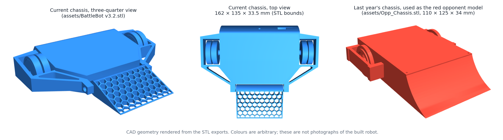
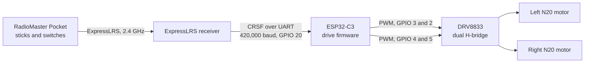
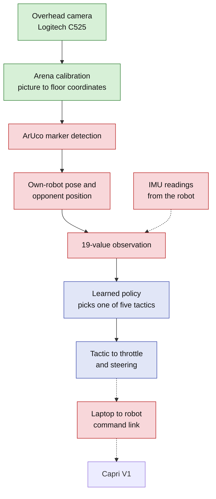

# Capri

**Capri** is a university antweight (150 g class) combat robot project. Its first prototype, **Capri V1**, is a
two-wheel passive-wedge pusher that was built with the aim of fighting autonomously: an overhead camera tracks both
robots, a learned policy on a laptop chooses what to do, and the robot carries it out, with a hand-held transmitter
always able to take over.

Capri V1 competed at the BEEES antweight competition on 21 November 2026 **under manual control**. Its wedge worked
well. Its autonomy did not reach the arena: the camera could map the arena but could not reliably track the robot's
markers at competition distance, so the autonomous pipeline never had a usable picture of the real world. This
repository documents that first iteration honestly, including what failed, and is the starting point for the next one.



*Capri V1 chassis (left and centre) and the previous year's chassis used as the simulated opponent (right). These are
renders of the CAD files in `assets/`, not photographs. There is no photograph of the built robot in the repository yet.*

> **Status, 22 November 2026.** Capri V1 is complete as a prototype and is not being developed further in its current
> form. Capri V2 is at the ideas stage; nothing for it is designed or built. See [Future development](#future-development).

## Contents

- [Capri overview](#capri-overview)
- [Capri V1](#capri-v1)
- [Hardware architecture](#hardware-architecture)
- [Software and firmware](#software-and-firmware)
- [Features and functionality](#features-and-functionality)
- [Development status](#development-status)
- [Testing and known limitations](#testing-and-known-limitations)
- [Lessons learned](#lessons-learned)
- [Future development](#future-development)
- [Repository structure](#repository-structure)
- [Build and setup](#build-and-setup)
- [Naming](#naming)
- [Documentation](#documentation)

## Capri overview

The project has four parts. They were developed largely separately, and joining them was the unfinished work.

| Part | What it is | Where |
|---|---|---|
| **The robot** | Wedge chassis, two N20 motors, DRV8833 driver, ESP32-C3, ExpressLRS receiver, LSM6DS3 IMU | [`hardware/`](hardware/README.md), `assets/`, `ELRS-*/` |
| **Firmware** | Arduino sketches: manual drive, and a RADIO/PC handoff with the transmitter as the only arming authority | `ELRS-Control/`, `ELRS-Handoff-*/` |
| **Command Centre** | A desktop application for the camera, arena calibration, robot tracking, link status and match workflow | `control_center/`, [docs](docs/command-centre.md) |
| **Simulator** | A MuJoCo model of the arena and both robots, with training, evaluation and human-versus-policy play | `autobot/sim/`, `scripts/`, [docs](docs/simulator.md) |

The detailed engineering record, with every claim tied to evidence, is the **[case study](docs/case-study/README.md)**.

## Capri V1

### What it was meant to achieve

An antweight that fights without a driver. The intended loop was:

1. An overhead camera sees the whole arena.
2. Software maps the picture onto the arena floor and locates Capri (by fiducial markers) and the opponent.
3. A policy trained in simulation picks a tactic from those positions and the robot's inertial readings.
4. The laptop sends the resulting drive command to the robot.
5. The RadioMaster transmitter can arm, disarm and take over at any time.

### Design

A low wedge with a honeycomb scoop at the nose and a driven wheel at each side (162 x 135 x 33.5 mm in CAD), with no
active weapon. Two N20 gear motors through a DRV8833, an ESP32-C3 running the drive firmware, an ExpressLRS receiver for
the RadioMaster Pocket, and an LSM6DS3 IMU. Printed ArUco markers on the top, bottom and rear faces were for the
overhead camera. Full details and what was never measured: [hardware reference](hardware/README.md).

### How it went

The table separates what was shown at the competition from what was not. *Reported* means observed by the author with
no saved log, photo or video; *logged* means recorded by the laptop ([evidence](docs/competition-2026-11-21-evidence.md)).

| | Result | Basis |
|---|---|---|
| **Demonstrated at the competition** | | |
| Manual operation over ExpressLRS | Capri V1 took part in the competition driven from the RadioMaster Pocket | Reported |
| Arena mapping | The Command Centre calibrated the arena from the overhead camera and the operator confirmed the alignment | Logged, reported |
| Passive wedge | The very low leading edge got underneath many opponents and lifted or displaced them through forward drive alone | Reported |
| Wedge as a sacrificial part | Against a spinner, the front-left of the wedge took most of the damage and the electronics stayed protected | Reported |
| **Not achieved or not demonstrated** | | |
| Full-arena marker localisation | Markers detected close to the camera were not reliably detected with the robot on the arena floor | Reported, logged |
| Autonomous operation | Not attempted in any match. The policy has never controlled the physical robot | Repository state |
| Wi-Fi motor control with the policy in the loop | Never run. The Wi-Fi link itself was unstable the day before | Logged |
| **Unresolved** | | |
| Why marker detection failed at distance | Most likely too few pixels per marker with the Logitech C525. Plausible, not measured | Hypothesis |
| Occasional immobilisation | Capri sometimes became stuck with something trapped beneath its low underside | Reported; cause unknown |
| Earlier electrical instability | Supply collapse and restarts on 20 November; root cause not identified | Reported, logged |

**No match results, rankings or placements are recorded here**, because none were written down.

Using manual control was a deliberate fallback made at the event once tracking proved unreliable. It is not evidence
about the policy: the policy was never deployed on the robot, so it neither succeeded nor failed there.

### Verdict

Capri V1 was partly successful. Mechanically and operationally it worked: it drove, it competed, and its wedge was its
strongest feature. Against its original objective, autonomous operation, it was unsuccessful, because of real-world
perception and integration limits that software and synthetic testing had not exposed. It was an imperfect prototype
that showed clearly what to change, which is the case for building another.

## Hardware architecture

The only command path used at the competition:



| Component | Part | Notes |
|---|---|---|
| Microcontroller | ESP32-C3 | Arduino core; USB serial for status and bench commands |
| Motor driver | DRV8833 | Left motor on GPIO 3/2, right on GPIO 4/5 |
| Motors | 2 x N20 gear motors | Wheels 33.5 mm diameter, about 132 mm apart |
| Radio | ExpressLRS receiver + RadioMaster Pocket | Steering on channel 1, throttle on channel 2; ARM on 5 and MODE on 6 in the handoff firmware |
| IMU | LSM6DS3, I2C | Read in a bench test; not used by the firmware that competed |
| Power | Battery through a buck converter for logic | Power path not fully characterised; see known issues |
| Camera (off-robot) | Logitech C525 | 1280 x 720 |

Pin map, channel calibration, safety timeouts, measured voltages and the list of unrecorded values are in the
[hardware reference](hardware/README.md). The power wiring is not drawn above because it is not recorded.

## Software and firmware

### The intended autonomy pipeline, and where it stopped



Green: worked on the real camera at the event. Blue: works in the simulator only. Red: did not work, or was never
established, on the real system. Dashed arrows are connections that were never made on hardware.

### Components

| Component | Language | What it does | Verified on |
|---|---|---|---|
| `ELRS-Control` | Arduino C++ | RadioMaster-only drive: CRSF decode, arcade mixing, 250 ms failsafe, ten-frame start-up check | The robot |
| `ELRS-Handoff-Bench` | Arduino C++ | The drive code plus an ARM switch, a RADIO/PC switch and a USB command protocol. The PC can only send drive commands | The robot (normal path); mocked board (failure cases) |
| `ELRS-Handoff-WiFi` | Arduino C++ | The bench sketch plus a Wi-Fi access point and UDP link | The robot, unstable; mocked board |
| `ELRS-Handoff-Telemetry` | Arduino C++, generated | The Wi-Fi sketch plus read-only IMU telemetry | Mocked board only; never flashed |
| Command Centre (`control_center/`) | Python, PySide6, OpenCV | Camera, click-based arena calibration, marker and opponent tracking, link status, operating modes, round recording and review | Real camera for calibration; otherwise synthetic frames |
| Simulator (`autobot/sim/`) | Python, MuJoCo, Gymnasium, Stable-Baselines3 | Arena and robot physics, tactic-level environment, training, evaluation, live play, exact replay | Simulation |
| Experiment scripts (`scripts/`) | Python | Learning experiments, diagnostics, the PC handoff client, the movement check | Simulation and mocked board |
| Trajectory predictor (`autobot/prediction/`) | Python, PyTorch | Opponent path prediction from synthetic motion data | Smoke runs only; not used elsewhere |

**About "the policy".** Reinforcement learning (PPO) did not learn the pushing task in the simulator. The policy that
works there is a behaviour-cloned copy of a simple scripted pursuit controller, refined with DAgger and stored in a PPO
container. It reads simulator-truth positions, so it is a simulator result, not a robot controller. Its checkpoint zip
must stay beside its `effective_config.json`, which records the observation encoding not embedded in this older zip;
see the [verified policy schema](docs/policy-observation-schema.md). The story is
[sections 5 and 6 of the case study](docs/case-study/README.md#5-teaching-blue-to-push-what-failed-and-what-worked).

## Features and functionality

| Feature | State |
|---|---|
| Manual driving from the RadioMaster, on battery | **Demonstrated on hardware**, including at the competition |
| Failsafe stop on radio loss; start-up neutral check | Implemented; normal operation seen on hardware; failure cases tested on a mocked board only |
| Laptop keyboard driving over USB with RadioMaster arming and handoff | **Demonstrated on hardware** (tethered, normal path) |
| Laptop driving over Wi-Fi | Drove, then unstable; experimental |
| Arena calibration from an angled camera | **Demonstrated on the real camera** at the event; accuracy not independently checked |
| ArUco own-robot tracking | Implemented; works on rendered frames; **not reliable on the real camera at arena distance** |
| Opponent tracking by selection | Implemented; rendered frames and one historical recording only |
| Simulator with human-versus-policy play and exact replay | Working, simulation only |
| Learned pursuit policy | Working, simulation only |
| Autonomous mode in the Command Centre | Present behind a gate that is closed; never exercised on hardware |
| Round recording and review | Implemented; synthetic tests only |
| IMU telemetry from the robot | Firmware written and host-tested; never flashed |

## Development status

| Version | Status |
|---|---|
| **Capri V1** | Built, competed once (21 November 2026), manual control. Documented here. No further development planned on this design beyond investigating its open questions |
| **Capri V2** | Ideas only. No requirements, CAD, firmware or code |

A dated history is in the [changelog](CHANGELOG.md).

## Testing and known limitations

Most of Capri V1's testing was done in software: an automated suite runs the simulator, the Command Centre logic on
synthetic frames, and the real firmware sketches compiled for the PC against a mocked board. Hardware testing was
limited, and much of it was observed without being recorded. A passing software test is never treated as a hardware
result in this repository.

The main limitations, in order of how much they mattered:

1. **Perception at real distance.** Marker detection that worked close to the camera failed across the arena, and the
   marker sizes and positions were never measured into the configuration.
2. **No verified link from the laptop to the motors** without a cable, and no complete real-world observation for the
   policy.
3. **An unexplained electrical fault** the day before the competition: supply collapse and restarts on battery, root
   cause not identified. Wi-Fi was running at the time and has not been shown to be the cause.
4. **Unintended left-wheel movement** at reset and upload, cause unmeasured.
5. **Mechanical:** occasional immobilisation with something trapped underneath; the wedge is a wear part.
6. **Sparse records:** no photographs, no match records, several measurements taken from memory.

Each is described with its evidence in **[known issues](docs/known-issues.md)**. Test procedures are in the
[test playbook](docs/autobots-test-playbook.md).

## Lessons learned

1. **Test perception at the real working distance, early.** A marker that decodes at 30 cm says nothing about one seen
   from across an arena. Everything downstream depended on this and it was checked last.
2. **Synthetic and software tests do not transfer by themselves.** Rendered frames, mocked boards and the simulator all
   passed. The camera, the battery and the arena each behaved differently.
3. **Measure the configuration, not just the code.** The tracker was working as written; its marker dimensions were
   placeholders.
4. **Keep a fallback that is independent of the ambitious part.** Manual ELRS control was kept intact throughout, and
   it is the reason Capri V1 competed at all.
5. **A USB cable is a power supply.** Every tethered success hid the state of the battery path.
6. **Change one thing at a time when recovering,** and write measurements down when they are taken.
7. **A simple mechanical idea done well is worth a lot.** The low passive wedge was the most effective thing on the robot.
8. **Sacrificial parts work.** Losing some wedge is better than losing electronics; the wedge should be designed to be replaced.
9. **Measure the task before tuning the learner** (simulator): one diagnostic sweep explained three failed training changes.
10. **Record the day.** No photos, videos or match notes were kept, which limits what can be learned from the competition.

The simulator and integration lessons are developed in the [case study](docs/case-study/README.md#11-lessons-so-far).

## Future development

Another iteration is justified because V1 separated what works from what does not: the wedge and manual control are
worth keeping, and the autonomy objective is blocked by specific, testable problems, not by the idea.

Possible directions, none of them decided or started:

- **Capri V2 mechanical redesign** that keeps the low-profile wedge.
- **Modular, sacrificial wedge assemblies** that can be swapped between matches.
- **Improved drivetrain and traction**, and an underside less prone to trapping debris.
- **Encoder-equipped N20 motors** for wheel odometry.
- **Better power distribution** and electronics integration.
- **Improved camera and fiducial detection**, chosen by measurement at arena distance.
- **More reliable integration of manual and autonomous control.**
- **A possible active wedge or lifter.**
- **More structured testing and performance evaluation**, with results recorded as they happen.

Separate robot concepts (a shuffler, a horizontal spinner) are also being explored; they are not Capri V2 decisions.
The next university antweight competition is expected in March 2027. Details: **[roadmap](docs/roadmap.md)**.

## Repository structure

```text
.
├── README.md                    This file
├── CHANGELOG.md                 Dated development history
├── main_control_center.py       Entry point for the Command Centre
├── requirements.txt             Python dependencies
├── pytest.ini
├── ELRS-Control/                Firmware: original RadioMaster-only drive sketch (fallback)
├── ELRS-Handoff-Bench/          Firmware: RADIO/PC handoff over USB, with host tests
├── ELRS-Handoff-WiFi/           Firmware: handoff plus Wi-Fi link (experimental)
├── ELRS-Handoff-Telemetry/      Firmware: Wi-Fi plus IMU telemetry (generated, never flashed)
├── control_center/              Command Centre application (backend, screens, tools, widgets)
├── autobot/
│   ├── sim/                     MuJoCo simulator, environment, CLI
│   └── prediction/              Opponent trajectory predictor prototype
├── scripts/                     Experiments, diagnostics, PC handoff client, movement check
│   └── edgetx/                  EdgeTX Lua test script for the transmitter
├── config/                      Simulator, arena, overlay and scenario configuration
├── assets/                      Chassis CAD (STL)
├── hardware/                    Hardware reference and the September procurement list
├── tests/                       Automated tests (software only)
├── docs/
│   ├── case-study/              The engineering case study, figures and figure scripts
│   ├── images/                  Planning diagrams from October 2026
│   ├── known-issues.md
│   ├── roadmap.md
│   └── ...                      Command Centre, simulator, playbook, audits, design notes
└── logs/                        Local logs (git-ignored)
```

`runs/` (training output) and `artifacts/` (analysis output and handoff notes) are git-ignored and exist only on the
development machine.

## Build and setup

Developed on Windows 11 with Python 3.13. Commands are PowerShell, run from the repository root.

**Install**

```powershell
python -m pip install -r requirements.txt
```

**Run the tests** (software only; no camera, serial port or robot is used)

```powershell
python -m pytest
```

Last run on the development machine on 22 November 2026: 1,535 tests collected, **1,533 passed, 2 skipped**, in about
15 minutes. Setting `AUTOBOT_SKIP_SLOW=1` skips the slowest checkpoint tests. The firmware host tests compile the real
sketches for the PC and need the MSVC build tools. Tests that need training output under the git-ignored `runs/` and
`artifacts/` folders, or MSVC, are written to skip when those are absent, so a fresh clone will report more skips; that
has not been checked on a fresh clone.

**Open the Command Centre without hardware**

```powershell
python main_control_center.py --mock
```

`--mock` uses a synthetic camera and replayed controller lines and remembers nothing. Without it the application
opens the real camera. It never arms or drives the robot. See [docs/command-centre.md](docs/command-centre.md).

**Run the simulator**

```powershell
python -m autobot.sim.cli preview --opponent scripted --opponent-chassis last_year
```

W/A/S/D or the arrow keys drive, Space starts and pauses, R resets. See [docs/simulator.md](docs/simulator.md).

**Firmware**

The sketches build in the Arduino IDE for the board "ESP32C3 Dev Module" with "USB CDC On Boot: Enabled"
(esp32 core 3.3.0 was used). All four sketches were compiled for that board with `arduino-cli` 1.5.0 on 22 November
2026 as a build check only; nothing was uploaded. A successful build says nothing about behaviour on the robot.

| Sketch | Program size |
|---|---|
| `ELRS-Control` | 326,770 bytes |
| `ELRS-Handoff-Bench` | 329,850 bytes |
| `ELRS-Handoff-WiFi` | 983,390 bytes |
| `ELRS-Handoff-Telemetry` | 1,010,518 bytes |

Read the sketch's README and the [test playbook](docs/autobots-test-playbook.md) before uploading anything. Start
every bench test with the wheels off the ground, and do not connect USB and the battery together
([why](hardware/README.md#6-power)).

## Naming

| Name | Use |
|---|---|
| **Capri** | The robot and the project |
| **Capri V1** | The first prototype, described in this repository |
| **Capri V2** and later | Future iterations; nothing exists yet |

The project was called AutoBots until 22 November 2026. Some identifiers keep the old name on purpose, because
changing them would break builds, tests, saved checkpoints or the link between the laptop and the firmware:

| Identifier | Why it stays |
|---|---|
| The repository name, `AutoBots` | Renaming a repository and its remotes is a separate decision |
| Python package `autobot`; classes `AutoBotSim`, `AutoBotEnv` | Imported throughout, and recorded inside saved checkpoints |
| Firmware identifiers `autobot-handoff-bench-1`, `-wifi-1`, `-telemetry-1`; Wi-Fi name `AutoBot-Handoff` | Part of the protocol between firmware and PC, and inside hash-pinned sketches |
| Comments and banners inside the `.ino` sketches | The sketches are kept byte-identical to the builds that ran on the robot |
| `assets/BattleBot v3.2.stl` | The Capri V1 chassis CAD; the path is referenced by configuration |
| Environment variables `AUTOBOT_SKIP_SLOW`, `AUTOBOTS_FOOTAGE_MP4` | Used by the test suite |
| `docs/autobots-test-playbook.md` | Linked from firmware READMEs and local notes |
| "Blue" and "red" | In the simulator, blue is the policy's robot and red is the opponent |

## Documentation

| Document | What it covers |
|---|---|
| [Case study](docs/case-study/README.md) | The full engineering record of Capri V1, with evidence for each claim |
| [Known issues](docs/known-issues.md) | What failed, what is unverified, what is unexplained |
| [Roadmap](docs/roadmap.md) | Open questions and ideas for Capri V2 |
| [Changelog](CHANGELOG.md) | Dated development history |
| [Hardware reference](hardware/README.md) | Parts, pins, channels, safety behaviour, power readings |
| [Competition-day evidence](docs/competition-2026-11-21-evidence.md) | What the laptop recorded on 21 November 2026 |
| [Command Centre](docs/command-centre.md) | The desktop application |
| [Simulator](docs/simulator.md) | Simulator commands and learning experiments |
| [Test playbook](docs/autobots-test-playbook.md) | Bench and software test procedures |
| [ArUco tracking audit](docs/aruco-tracking-audit.md) | Marker dictionary, layout and tracker states |
| [Policy observation schema](docs/policy-observation-schema.md) | The 19 observation values and what the policy is |
| [Arena geometry](docs/arena-geometry.md) | Arena dimensions and their source |
| [ELRS relay feasibility](docs/elrs-relay-feasibility.md) | Desk study of sending PC commands through the transmitter |
| [Round recording format](docs/round-recording-format.md) | Files written when a round is recorded |
| [Design notes, September 2026](docs/design-notes-2026-09.md) | The original planning handbook; superseded where it differs from the above |
