# Capri V1: an antweight combat robot, a simulator that learned to chase, and a camera that maps the arena

**Status as of 22 November 2026** (third edition, written the day after the competition) · Competition day: 21 November 2026, [section 10](#10-competition-day-21-november-2026) · [Changelog](CHANGELOG.md)

> **The name.** The robot is called **Capri**, and the prototype this document describes is **Capri V1**. Until 22 November 2026 the project was called AutoBots. That name survives in the repository name, in code identifiers such as the `autobot` package, in firmware identifiers, and in file names quoted below; those were left alone so that nothing breaks. "The robot" and "my robot" in the earlier sections mean Capri V1.
>
> **The outcome, in one paragraph.** Capri V1 competed on 21 November 2026 under manual control from the RadioMaster. Its passive wedge worked well. It did not operate autonomously: the camera mapped the arena, but the robot's markers could not be tracked reliably at arena distance, so I drove by hand. The learned policy was never deployed on the robot, so the competition says nothing about how it would have performed. Sections 1 to 9 below are the record as it stood before the competition, with dated updates; [section 10](#10-competition-day-21-november-2026) is the day itself.

Capri is my antweight (150 g class) combat robot project. It is three working pieces. On 20 November the first connection between them was made, a laptop driving the motors, and the first attempt to make that connection wireless failed along with the robot's power supply ([section 7](#7-20-november-2026-wi-fi-integration-failures-and-the-decision-to-reuse-elrs)). The policy and the camera are still **not connected to the robot**:

| | What exists | How far it is verified |
|---|---|---|
| **Physical robot** | A wedge-fronted, two-wheel pusher driven by hand from a RadioMaster transmitter, with an IMU on board | **Hardware:** manual drive works, on battery, on the handoff firmware (20 Nov). A laptop keyboard has driven it over a USB cable. The IMU was read in a separate bench test. |
| **Simulator** | A MuJoCo model of the arena (two pits, fixed flipper corner) where I drive a red robot against a learned blue one, with logs that replay exactly | **Simulation only:** the current blue reaches red in 120 of 120 scripted test rounds and no longer spins when red drives away. |
| **Vision** | A read-only tool that turns an angled camera view into a top-down arena map and tracks robots on it | **Historical footage only:** tested on a public recording of a March event. My own camera has not been pointed at the arena yet. |

The learned policy has never controlled the physical robot, and nothing in this document claims it has. Only a keyboard has driven it from the laptop.

**Update, 22 November.** The table above is the state on 20 November and is left as written. Since then: the robot competed under manual control; my own camera was pointed at the arena and the arena mapping worked; marker tracking of my robot did not. The sentence above still holds after the competition.

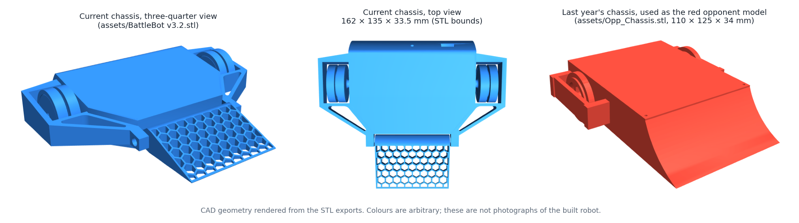

**Figure 1. The chassis, rendered from the CAD exports in the repository.** Left and centre: the current robot, a low wedge with a honeycomb scoop at the nose and a wheel at each side. Right: last year's chassis, which the simulator uses as the red opponent. These are renders of the STL geometry, not photographs. No photo of the built robot is in the repository yet ([missing assets](#appendix-e-not-yet-documented)).

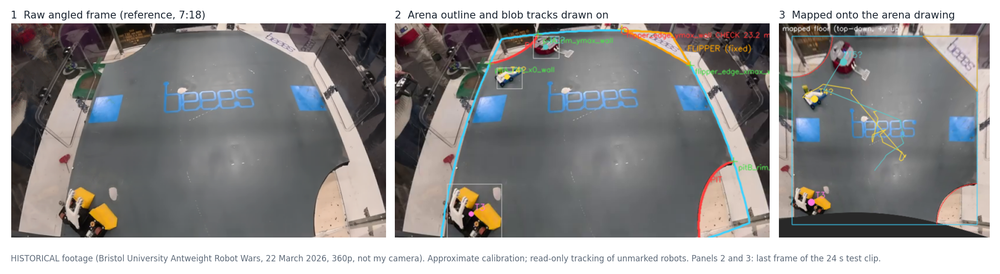

**Figure 2. An angled camera view mapped onto the arena drawing.** Panel 1 is a raw frame from a wide-angle camera above one corner of the arena. Panel 2 is the same view with the pits, the fixed flipper boundary and three tracked robots drawn on. Panel 3 is that view warped onto the arena drawing, with each robot's path over the previous 24 seconds. Notice that the curved floor edges in panel 1 become the straight sides of a square in panel 3. This is **historical footage** from March 2026, the calibration is **approximate**, and the tool only reads video.

## What I can demonstrate today

1. **Drive the robot by hand** from the RadioMaster. *Hardware.*
2. **Play a live match in the simulator**: I drive red with the keyboard and the learned blue chases me. *Simulation.*
3. **Replay a failure and its fix**: a recorded round in which the old blue spun on the spot for 12 seconds, then the same recorded inputs against the current blue. *Simulation, fixed-input replay.*
4. **Show the arena overlay** running on the March footage, with robots tracked on a top-down map. *Historical footage.*
5. **Drive the robot from the laptop keyboard over a USB cable**, and hand control between laptop and RadioMaster with a switch. *Hardware, tethered, demonstrated on 20 November.* Repeating it with the battery connected waits on a power question raised that day ([7.3](#73-the-measurements-and-what-they-do-and-do-not-show)).

**Added after the competition (22 November):**

6. **Map the arena from my own camera.** *Hardware camera, logged on 21 November;* accuracy not independently checked ([10.3](#103-the-camera-calibration-worked)).
7. **Get under an opponent with the wedge and move it.** *Reported from the competition;* there is no photo or video ([10.6](#106-the-wedge)).

What I still cannot demonstrate is the robot acting on anything the laptop sees.

The most interesting engineering is in items 2 and 3: [how the blue policy came to exist](#5-teaching-blue-to-push-what-failed-and-what-worked), and [how one live round exposed a failure that 774 scripted benchmark rounds had not](#6-the-debugging-story-blue-spun-when-i-drove-away). The most recent, and the least comfortable, is [the day the hardware integration failed and the plan changed](#7-20-november-2026-wi-fi-integration-failures-and-the-decision-to-reuse-elrs).

## Contents

1. [The three parts and how they relate](#1-the-three-parts-and-how-they-relate)
2. [The physical robot](#2-the-physical-robot)
3. [The simulator](#3-the-simulator)
4. [Vision](#4-vision)
5. [Teaching blue to push: what failed and what worked](#5-teaching-blue-to-push-what-failed-and-what-worked)
6. [The debugging story: blue spun when I drove away](#6-the-debugging-story-blue-spun-when-i-drove-away)
7. [20 November 2026: Wi-Fi integration failures and the decision to reuse ELRS](#7-20-november-2026-wi-fi-integration-failures-and-the-decision-to-reuse-elrs)
8. [What is verified, and where](#8-what-is-verified-and-where)
9. [Who did what](#9-who-did-what)
10. [Competition day (21 November 2026)](#10-competition-day-21-november-2026)
11. [Lessons so far](#11-lessons-so-far)

Appendices: [A. Dated timeline](#appendix-a-dated-timeline) · [B. Experiment record](#appendix-b-experiment-record) · [C. Evidence index](#appendix-c-evidence-index) · [D. Demo commands](#appendix-d-demo-commands) · [E. Not yet documented](#appendix-e-not-yet-documented) · [F. Rebuilding the figures](#appendix-f-rebuilding-the-figures)

**Evidence labels used throughout.** *Hardware*: seen on the real robot. *Simulation*: MuJoCo only. *Fixed-input replay*: a recorded command stream played back, so the recorded robot cannot react. *Historical footage*: the March recording, not my camera. *Synthetic*: rendered test images. *Planned*: not built or not tested. Section 7 adds four words of its own for the integration work: *demonstrated on hardware*, *tested in software*, *proposed*, and *blocked / unverified*. Section 10 adds two for the competition: *reported* (what I saw at the event, with no log, photo or video saved) and *logged* (recorded by the laptop that morning).

---

## 1. The three parts and how they relate

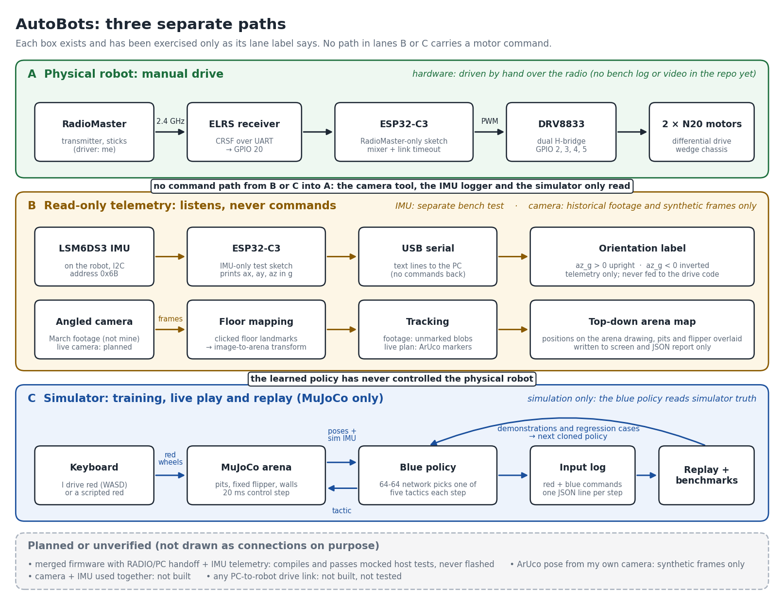

**Figure 3. Three separate paths.** Lane A is the only path that reaches the motors: transmitter, receiver, microcontroller, motor driver. Lane B only listens: an IMU test that prints readings over USB, and a camera tool that writes a map to the screen. Lane C lives entirely inside the simulator. There is no arrow from B or C into A because no such link has been built. The dashed box at the bottom lists what is planned or only tested in software.

In plain terms:

- **The robot** is a radio-controlled pusher. I steer it; nothing on it decides anything.
- **The simulator** is where a policy learned to play. It answers "what should blue do, given where both robots are?" using positions that only a simulator can know exactly.
- **The vision tool** is the first step toward giving a real robot those positions: it works out where things are on the arena floor from a camera image.

**Update, 20 November.** Figure 3 shows the state on 18 November and is left as it was. Since then lane A has gained one input from the laptop: keyboard commands through firmware that leaves arming and override with the RadioMaster, demonstrated over USB and, briefly, over Wi-Fi. There is still no arrow from the simulator's policy or from the camera to the robot. The architecture that was attempted and the one that replaced it as the target are both drawn in [section 7](#7-20-november-2026-wi-fi-integration-failures-and-the-decision-to-reuse-elrs).

Joining them (camera positions in, radio commands out) is the long-term goal. The [original architecture plan](../images/planned-architecture-command-control-2026-10.png) from October shows that intended loop. This case study documents the three pieces as they stand, and is explicit about the gaps between them.

## 2. The physical robot

**What it is.** A two-wheel differential-drive pusher: two N20 gear motors, a DRV8833 dual H-bridge, an ESP32-C3 microcontroller, an ExpressLRS receiver, and an LSM6DS3 IMU. The chassis CAD (`assets/BattleBot v3.2.stl`) is 162 × 135 × 33.5 mm: a wedge with a honeycomb scoop at the nose and the wheels set back at the sides (Figure 1). Wheel diameter (33.5 mm) and wheel spacing (about 132 mm) are recorded in the simulator config as physical measurements.

**Manual drive.** *Hardware.* The drive sketch (10 November) reads CRSF channel frames from the receiver at 420,000 baud on GPIO 20, mixes steering (channel 1) and throttle (channel 2) into left and right motor commands on GPIO 3/2 and 4/5, waits for ten consecutive valid frames before allowing movement, and stops if no valid frame arrives for 250 ms. A byte-identical copy is kept read-only as the fallback for competition day.

The simulator's calibration command carries physical timing targets for this robot: 2.03 m in 3.00 s in a straight line (about 0.68 m/s), and 8.25 turns on the spot in 4.65 s. The repository does not record how those were measured, and there is no bench log or video of the robot driving.

**IMU bench test.** *Hardware, separate from driving.* On 17 November an IMU-only test sketch found the LSM6DS3 on the I2C bus at address 0x6B (WHO_AM_I 0x69) and printed acceleration in g. Flipping the robot by hand gave three confirmed upright/inverted transitions: for my mounting, positive `az_g` means upright and negative means inverted. **The serial log of that test was not saved in the repository, so there is no plot here**; I am not reconstructing one from memory.

Two things came out of that test that matter more than the reading itself:

- **The IMU-only sketch unexpectedly drove the left wheel.** The cause is not confirmed. The leading explanation is that the left motor's reverse input sits on GPIO 2, a boot strapping pin that may be pulled high while the chip is in reset or being flashed. That would drive only the left wheel, around resets and uploads, with any sketch. A multimeter check with the motors disconnected will settle it.
- **The plan said SPI; the real sensor is on I2C.** The project handbook had not caught up with the wiring. The pins the sensor is actually on (6 and 7 in the test sketch) have not been confirmed by eye, so the merged firmware leaves them unset.

After the wheel incident I set working rules for firmware: nothing is flashed by an agent, no serial port is opened by an agent, bench steps start with the motors physically disconnected, and a passing build is never reported as evidence of safe hardware behaviour.

**What exists only in software.** A merged sketch adds a RADIO/PC source switch and IMU telemetry to the drive sketch. It compiles (353,202 bytes) and passes mocked host tests (104 to 108 checks per variant, covering boot, disarm, source switching with a stick held, stale PC commands, radio loss and re-arm). **It has never been flashed.** A reading of the ESP32 core source also predicts that the current drive sketch may not brake after driving forward or when the transmitter goes off. That contradicts my experience of driving it, so the reading may be wrong; it is an open question with a bench step written for it, not a finding.

**Update, 20 November.** The paragraph above describes 18 November. The merged sketch it mentions was not flashed; it was replaced on 19 November by a smaller standalone sketch, `ELRS-Handoff-Bench`, with the same drive code plus an ARM switch and a RADIO/PC switch and no IMU. That sketch has now been flashed and driven, and since the night of 20 November it is the firmware on the robot. The original drive sketch is unchanged on disk as the fallback behind it. The left wheel moved at reset again on 20 November; the strapping-pin explanation is still unmeasured. The stop-path question is also still open: the bench step written for it has not been run. What happened when the robot first ran new firmware on its own battery is [section 7](#7-20-november-2026-wi-fi-integration-failures-and-the-decision-to-reuse-elrs).

Evidence: local `artifacts/firmware-handoff-review-2026-11-18.md` · [drive sketch](../../ELRS-Control/ELRS-Control.ino) · [handoff sketch](../../ELRS-Handoff-Bench/ELRS-Handoff-Bench.ino) · local `artifacts/run-sheet-2026-11-19.md`

## 3. The simulator

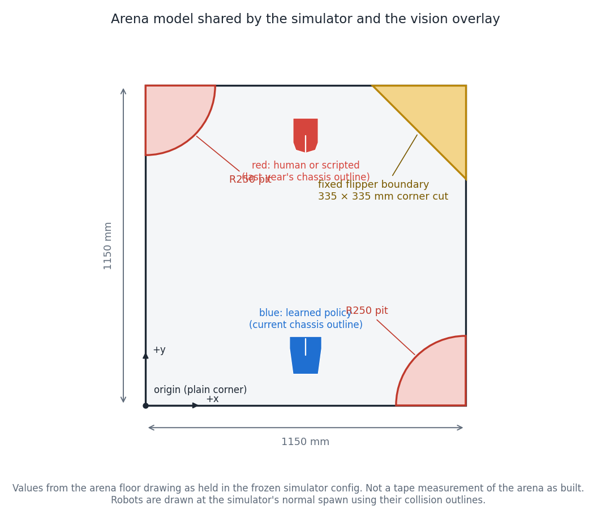

**Figure 4. The arena model.** A 1150 mm square floor, a quarter-circle pit of radius 250 mm in two opposite corners, and a fixed triangular flipper boundary in a third. The simulator and the vision tool share these numbers and this coordinate frame. They come from the arena floor drawing and have not been checked with a tape measure against the arena as built.

| | |
|---|---|
| 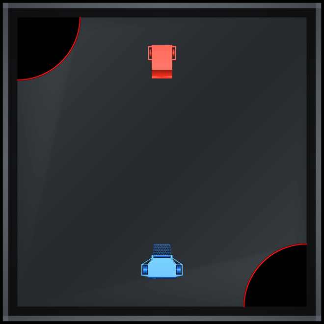 | 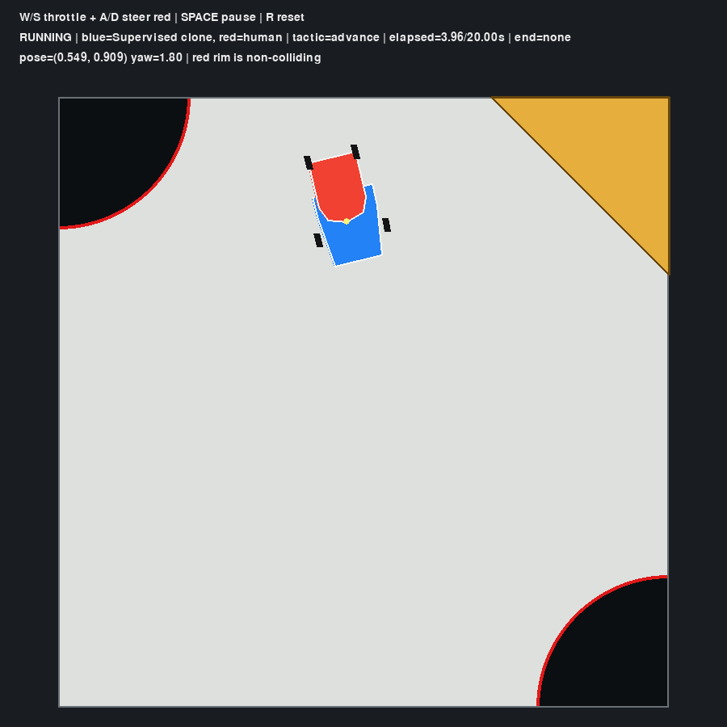 |

**Figure 5. Two views of the simulator.** Left: MuJoCo's 3D view at the normal spawn, with the CAD meshes of both robots. Right: the 2D play window. The status line shows who is driving each robot, blue's current tactic and the clock. The right-hand frame was captured during an automated check of the play loop with synthetic key presses, not during one of my sessions.

**How it works.**

- **Physics:** MuJoCo, 2 ms timestep, decisions every 20 ms, 20-second rounds. Pits are real holes in the floor: a round ends when a chassis centre drops below floor level. Walls are solid and touching them is not a loss.
- **What blue chooses:** one of five tactics per decision (stop, advance, reverse, turn left, turn right). A fixed low-level controller turns the tactic into wheel commands. The policy never sets wheel speeds directly.
- **What blue sees:** 19 numbers: simulated gyro and accelerometer readings, its own position and heading, red's position, and seven unused channels held at zero. It cannot see red's heading or speed and has no memory. Position inputs are simulator truth, which is why every policy here is labelled simulation-only.
- **Human against bot:** I drive red with W/A/S/D at real-time speed. Every session writes a log with one line per 20 ms step.
- **Reproducible replays:** given the same seed and the logged red commands, the simulator reproduces a round exactly. For the round analysed in section 6, blue's choice matches the log at 2,000 of 2,000 decisions.

**How blue was evaluated.** The habits below came from mistakes, and they are why I trust the later results more than the early ones:

- Start positions are split into training, validation and held-out sets that never overlap. Headline numbers use held-out starts only.
- Each start is run with three evaluation seeds, and the policy acts greedily.
- Every table includes two baselines: **Always-Advance** (drive forward forever) and **Always-Stop**. If Always-Stop "wins" a case, red fell in by itself and nobody gets credit.
- Results are split by pit. Pooled tables hid the fact that early policies only ever pushed at one pit.
- The rule for "is this policy worth keeping?" is written into the script before the run.

**Known gap to the real robot.** On the calibration command the simulated robot covers 1.64 m where the real one covered 2.03 m, and makes 3.43 turns where the real one made 8.25. The physics has not been tuned to close that gap. The simulator is a place to study behaviour, not yet a model of my robot's speed.

Evidence: local `runs/ppo-curriculum-overnight/effective_sim.yaml` · [simulator guide](../simulator.md) (the repository README's simulator section until 22 November) · local `artifacts/realtime-play-changes.md` · local `artifacts/gamma-comparison-handoff.md`

## 4. Vision

**The idea.** A camera looking down at an angle sees the square arena floor as a distorted quadrilateral. Because the floor is flat, a single transform maps any floor pixel to a floor position. Find that transform from a few landmarks whose real positions are known (where a pit rim meets a wall, where the flipper boundary meets a wall), and every pixel on the floor becomes a coordinate in metres.

**What the tool does.** *Read-only throughout.*

1. **Floor mapping.** I click floor-level landmarks in the image. At least four are used to fit the transform; any others are held out, and the tool reports the error at those. It grades each fit OK, WEAK or INSUFFICIENT and says why.
2. **Fixed hazards.** The pits and flipper boundary are drawn from the arena drawing, not detected.
3. **Robot position.** Two methods, at very different stages (below).

### Two footage sources that must not be confused

| | The March recording | My competition-day camera |
|---|---|---|
| What it is | A public 360p recording of Bristol University Antweight Robot Wars, 22 March 2026, filmed by the event's videographer | My own camera on a stand, on 21 November |
| Camera position | Wide-angle lens above one corner | Different, and unknown until the day |
| Used for | Testing the mapping and a tracker on real footage | The actual live setup |
| Calibration | Saved as a profile marked *historical*; the tool refuses to use it with a live camera | Must be clicked fresh on the day; nothing is copied from the recording |
| Status | **Tested** | **Planned.** No real camera has been opened by the tool. |

### On the historical footage

- **Lens.** The recording is a fisheye view. The lens was estimated from how straight the straight floor edges become (focal length about 348 px at 640 × 360), which does not rely on the arena drawing.
- **Landmarks.** Only five floor-level junctions are visible; the near corner is cropped and a large robot sits in it. Four were used to fit and one was held out.
- **Fit quality.** The error at the one held-out landmark is **23 mm**. That is one point, not an overall accuracy figure. Leaving each landmark out in turn gives 23, 25, 31, 52 and 80 mm. Traced floor edges sit within about 1 cm of the drawing where they are visible. The tool grades the fit **WEAK**, correctly: the fit points are all on the far and right sides, so a one-pixel click error moves the map by about 34 mm in the near-left corner.
- **Tracking unmarked robots.** Robots in the recording carry no markers, so a small offline tracker follows robot-sized blobs that differ from a background built from the whole recording. On a 24-second clip it followed two moving robots and one parked one. When the two touched, it reported **no position** for either rather than guessing (482 of 719 frames). Identity after they separated was correct at the five moments that were checked by eye, and the tracker flagged its own doubt once. It gives position to within a few centimetres and no heading.

### The planned live setup

- **ArUco markers** on the robot's top and bottom faces would give position, heading and which way up it is. The marker pose code corrects for the marker sitting above the floor: on synthetic images, ignoring marker height put the robot 21 to 41 mm away from its true position, and the correction brought that under 0.3 mm. *Synthetic only.* No marker has been printed, and the marker detector found nothing in the March footage because there was nothing to find.
- **The IMU** would cover moments when the camera cannot see the markers, and report inversion directly. *Planned.* Camera and IMU have not been used together.

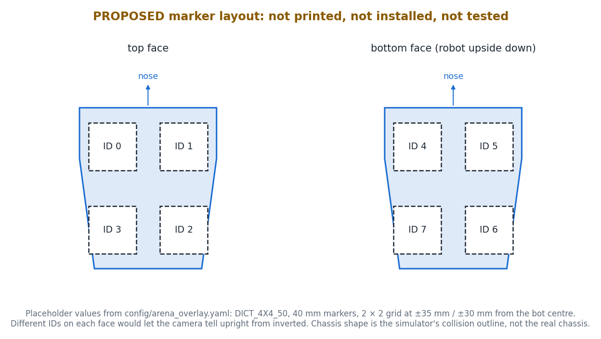

**Figure 6. Proposed marker layout.** Four markers per face, with different IDs on top and bottom so the camera can tell which way up the robot is. Every number here is a placeholder in the config. Nothing has been printed, installed or tested.

**Update, 20 November.** Markers are now on the robot: four on top, four underneath, and one on the rear face that I believe is ID 8. None of that is in the config yet: dictionary, IDs, sizes, heights and offsets are still placeholders, and Figure 6 is still the proposal, not a record of what was fitted. In the current camera view individual markers are detected only now and then. Three pieces of software were written that night in response, and so far they have only seen rendered frames: a tracker that fuses whichever markers agree in each frame, rejects one that disagrees, carries the pose forward for at most a fifth of a second, and then says *stale* and *lost* instead of holding an old position; a way to click an unmarked opponent in the picture and follow it, which reports *ambiguous* with no position during contact and needs a new click once it is lost; and a survey tool that reports which dictionary and IDs the camera actually sees and how often. *Synthetic only.*

**Update, 21 November.** My own camera was used at the competition. The floor mapping worked: four corners clicked, hazards placed from the design drawing, alignment confirmed. Marker tracking of my robot did not work at arena distance, and the marker sizes and positions were still the placeholders described above. What happened, and what the laptop logged, is [section 10](#10-competition-day-21-november-2026). The "planned" column of the table at the top of this section is therefore half done: the calibration was clicked fresh on the day, and the tracking it was meant to support was not achieved.

**Earlier vision work.** In September the desktop control centre showed a Logitech C525 feed at 1280 × 720 and 30 frames per second with AprilTag detection running in about 5 ms per frame. In October I added a small recurrent network that predicts an opponent's path from synthetic motion data; it has only had smoke-test runs and is not part of anything described above.

Evidence: local `artifacts/vision-overlay-handoff.md` · local `artifacts/vision-footage-handoff.md` · local `artifacts/vision-footage/historical_bristol_2026_03_22/report.json` · local `logs/`

---

## 5. Teaching blue to push: what failed and what worked

The goal was simple to state: from an ordinary start, blue should get behind red and push it into a pit. Over four days, reinforcement learning never learned it, and a much less fashionable method did.

The experiments in this section and the next were implemented and run by coding agents, to questions and stopping rules I set ([who did what](#9-who-did-what)).

### 5.1 The first policy reversed into a wall (14 November)

The first training reward only punished blue for falling into a pit. PPO found the perfect answer: never go near one.

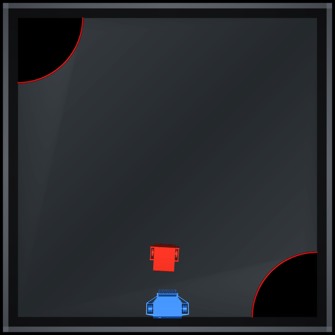

**Figure 7. The first learned policy, 14 November.** Blue (bottom) has reversed into the wall behind its spawn and stays there while red drives up to it. In the measured run it chose `reverse` at all 1,000 decisions and sat motionless against the wall for 974 of them.

**The change:** reward the outcome instead: +1 when red falls, −1 when blue falls. **The result:** the same behaviour. Across four normal starts the new final checkpoint chose `reverse` at 4,000 of 4,000 decisions. Reversing is still the safest thing to do if you have never once experienced a win.

**What that showed:** the reward was not the problem. Blue was never getting close enough to a win by chance to learn that one was possible.

### 5.2 Eight hours of training produced jitter (15 November)

**The change:** a curriculum. Start blue right behind red at the edge of a pit so that wins happen, then widen out to ordinary starts. It trained for eight hours (5.25 million steps).

**The result:** blue won the near-pit starts and nothing else: 0 wins on the 12 normal-start evaluations. Worse, it had learned to vibrate. It switched tactic about 35 times per second, mostly flipping between `turn_left` and `turn_right`, and barely moved. I played it by hand and recorded the rounds; in the recording, 63.5% of its decisions were inside left-right-left-right runs.

### 5.3 Three changes that did not solve it

Each of these was a reasonable hypothesis, tested as a matched comparison with everything else held fixed.

| Change | Why I tried it | What the comparison showed | What it did not show |
|---|---|---|---|
| **Bigger action space** (add two curved-turn tactics) | Maybe blue jitters because it cannot turn while moving | The 7-action policy jittered just as much (34 to 46 switches per second on normal starts). 0 normal-start wins for either. | One seed, 100k steps: too small to rank the two action sets, enough to see neither fixed it |
| **Hide blue's previous action from itself** | Trace analysis: in near-identical states, blue chose differently 85% of the time when its *previous choice* differed and 12% when it was the same, so it was oscillating on its own feedback | Jitter vanished in all three seeds (at most 0.05 switches per second). But the policies collapsed to a single tactic: two became Always-Advance, one reversed into the wall. 0 wins. | That the jitter was the reason for losing. It was a symptom. |
| **Longer horizon** (discount 0.999 instead of 0.99) | A win 800 decisions away is worth almost nothing at the start under the default discount | No normal-start wins at either setting over 1 million steps and two seeds. Of 2,302 ordinary-start training episodes, 12 were wins. | Nothing about exploration settings, which were left alone |

The discount experiment did produce the key observation. Blue *was* reaching red and pushing it. It was pushing in the wrong direction and never corrected.

### 5.4 The turning drill showed what was actually missing

The next step was to stop training and measure the task. Put red 0.3 to 0.8 m from a pit, put blue just behind it, and rotate blue's heading away from the line to the pit:

| Policy | Blue aligned (0 to 10°) | Blue misaligned (20 to 90°) |
|---|---|---|
| Always-Advance | 72 of 72 | **0 of 180** |
| Hand-written "turn, then advance" controller | 72 of 72 | **174 of 180** |
| Best learned policy at the time | 45 of 72 | 21 of 180 |

*Simulation; scripted red.* Driving straight wins every aligned push and no misaligned one. The cut-off is sharp: Always-Advance wins at heading offsets up to 12° and never from 14°. And every near-pit start in the curriculum was within 4° of the pit line. **Nothing in training had ever rewarded turning.** A random policy won 80 to 93% of the curriculum's near-pit starts and 0% of ordinary ones, with nothing in between to climb.

**The change:** a "heading ladder", a turning drill where every episode needs a turn first, starting at 16° and stepping up to 90° only as blue clears each rung.

**The result:** nine PPO runs, and none cleared the first rung. Once blue learned to push, it chose `advance` on 97 to 99.99% of decisions and stopped trying anything else. In the 11 episodes (of 1,173) where it happened to turn first, it won all 11. It simply never tried often enough to notice.

The drill also exposed a second flaw. Every PPO policy had learned to push at one pit and not the other. The two pits are mirror images, and in blue's observation the position inputs at one pit are exactly the negatives of those at the other, so a preference learned at one pit arrived reversed at the other. Earlier pooled tables had hidden this: "27 of 72" had really been "27 of 36 at one pit, 0 of 36 at the other".

### 5.5 Copying the controller worked where reinforcement learning had not

Was the task unlearnable from what blue could see, or was PPO failing to find it? One test separates those: take the exact same network, show it the exact same observations, and train it by plain supervised learning to copy the hand-written controller's choices (**behaviour cloning**).

It worked immediately: 312 to 317 wins on the 324 held-out turning starts, across three seeds, at both pits. A linear model scored 0, so the hidden layers matter, but the standard 64-64 network was enough. The observations were sufficient and the network could represent the skill. The failure belonged to the learning method.

**The obvious next step was to combine them:** start PPO from the working clone and let it improve.

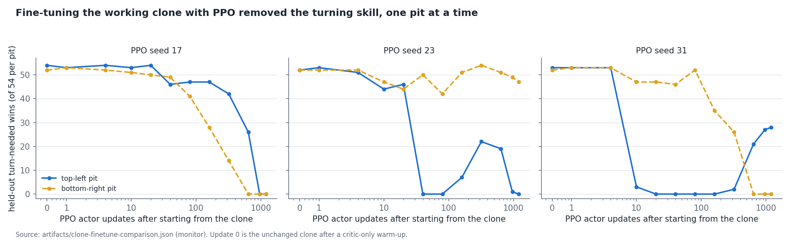

**Figure 8. PPO fine-tuning erased the cloned skill.** Each panel is one training seed. The lines count held-out turning-drill wins at each pit as PPO updates the network (horizontal axis is logarithmic). All three start near 54 of 54 at both pits. In two seeds one pit collapses within 10 to 40 updates, and in the third the loss is slower; by the end the three runs keep the skill, at best partly, at zero, one and one pit. Warming up the value estimate first did not prevent it.

No fine-tuned checkpoint won an ordinary start that Always-Advance does not also win. My reading is that the clone fell into a pit on most ordinary starts, and PPO un-learning those falls took the pushing skill with it. The pilot does not prove that reading: it cannot rule out PPO simply being unstable at these settings.

### 5.6 One network for both jobs: balanced cloning and DAgger

If the clone's problem was that it had never been shown ordinary starts, show it some. The same controller was recorded on 120 ordinary starts, and three recipes were compared on validation starts only:

| Recipe | Turning drill (72 per pit) | Ordinary starts (120): wins / own falls | Verdict |
|---|---|---|---|
| Pool everything together | 49 / 59 | 21 / 12 | Loses the drill: ordinary decisions outnumber drill decisions 21 to 1 |
| Balance each training batch half and half | 72 / 72 | 18 / 5 | Keeps the drill, still falls in |
| Balanced, then four rounds of **DAgger** | 72 / 72 | 23 / 0 | **Selected** |

DAgger lets the student drive, then asks the controller what it would have done in the situations the student actually got itself into, and trains on those. It is what removed the falls: the student now had examples from its own mistakes.

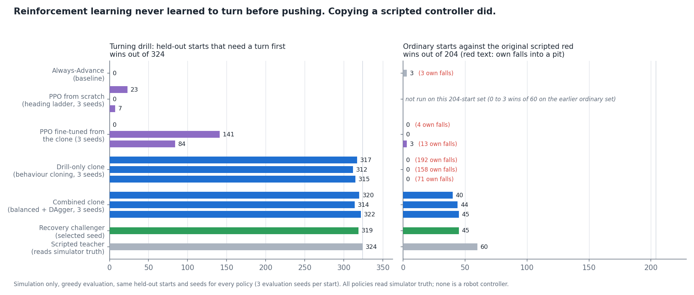

**Figure 9. What worked.** Left: held-out turning-drill wins out of 324. Right: ordinary-start wins out of 204, with own falls in red. Purple bars are reinforcement learning, blue bars are cloning, each bar is one seed. Reinforcement learning from scratch tops out at 23 of 324. Cloning the drill alone gets 312 to 317 but wins no ordinary start and falls into a pit 71 to 192 times. The combined clone keeps the drill (314 to 322) *and* wins 40 to 45 ordinary starts with zero own falls in 612 episodes. It does not beat the scripted teacher it copies (60).

**What this did not show.** The combined clone is a copy of a controller that reads simulator truth. It wins ordinary starts almost only from one of four start families, always at the same pit, because that is where its teacher wins. Its ceiling is the teacher's.

### 5.7 Knowing when not to train (17 November)

The original scripted red stops when it gets close. Real opponents do not. Five harder red driving styles were written (persistent follower, curved approach, stop-and-go, reactive direction changes, and a pit-pusher kept out of all training), with a rule fixed before anything ran: train a new clone only if the teacher beats the current clone by a clear margin on at least two styles.

It did not. The teacher won 39 of 256 cases against these reds; the clone won 24. Cloning the teacher further would have meant fitting to demonstrations that were more than 80% timeouts. **No training was run.** The combined clone stayed as the reference, with its limits written down: against harder reds it mostly timed out (28 wins, 4 own falls, 167 timeouts in 200 test rounds).

---

## 6. The debugging story: blue spun when I drove away

### 6.1 What happened

Just after midnight on 18 November I played two live rounds against the reference clone from the normal spawn. In the second, I drove red past blue and away. Blue turned on the spot and kept turning until the clock ran out.

### 6.2 The recorded inputs reproduced it

The session log held my commands for every 20 ms step. Replayed with the same seed, blue made the identical choice at 2,000 of 2,000 decisions across both rounds. The bug was now a file.

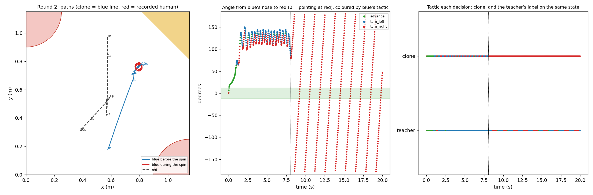

**Figure 10. The recorded round.** Left: red (dashed) drives down past blue and away to the lower left; blue (solid) ends in a tight red knot where it spins. Centre: the angle from blue's nose to red over time, where zero means pointing straight at red. From 8 seconds on, the angle sweeps the full circle again and again: blue's nose passes over red nine times and it never drives forward. Right: blue's choice at each decision, above what its teacher would have chosen in the same state.

The numbers for the spin: `turn_right` held for 597 consecutive decisions; 3,210° of rotation (8.9 turns) at 269° per second; blue's centre moved less than 3.2 cm; red sat between 0.51 and 0.59 m away the whole time.

### 6.3 Finding the cause

Three hypotheses, in the order they were ruled out:

1. **"Blue is not receiving red's position in play mode."** *False.* The input handed to the policy inside the real play loop was captured over 203 decisions and matched an independent rebuild from simulator state to within 3 × 10⁻⁸. Red's position was arriving, and blue's choices changed when it changed.
2. **"The clone is an imperfect copy; the teacher would have coped."** *False, and this was the important one.* Put in the clone's place just before the spin, the teacher drove toward red, stopped 0.27 m away, and flipped between left and right turns for the remaining 10 seconds without ever touching it. It parks on its own "go round red" waypoint, and from there its route still passes too close to red, so the waypoint never changes.
3. **"Red left the situations blue was trained on."** *True.* In all the demonstrations, the scripted red always closes in. Red was more than 0.45 m from blue on only 2.7% of demonstration decisions. From 1.4 seconds into the round, every state was further from the training data than 99% of held-out demonstration states were.

So the clone had faithfully copied a teacher that itself fails when the opponent drives away, and then extrapolated badly from there. **More demonstrations from that teacher could not have fixed it.** A probe over 291 red positions, with blue frozen where it began to spin, showed the spin was not a one-off: the clone spun at 33 of them, and never reached red within 10 seconds at 273 ([probe map](figures/spin-red-position-probe.png)).

The recorded round was saved as a regression case with a deliberately low bar: no 720° of one-way rotation without advancing, touch red after the point where the spin began, do not fall in. The clone fails it. The teacher fails it. Always-Advance passes it.

### 6.4 The fix: a simpler teacher

Since the teacher was the problem, the teacher was replaced. The new one is about as simple as a controller gets: **turn toward where red is now; drive forward when the nose is within 12° of it.** It uses only what blue's observation contains.

Before training anything, that controller had to pass a gate fixed in advance: recover on my recorded round, reach red on fresh cases without stalling or falling, and keep the turning drill. It passed (144 of 144 fresh cases reached, against the old teacher's 81).

**First challenger.** The same balanced-cloning-plus-DAgger recipe, with the new teacher and the original drill examples kept. It passed every test-set check. Then it was placed at the saved state from just before my spin, and none of its three seeds reached red. All of its training rounds had started with blue at the bottom of the arena. It had learned to chase from there and nowhere else.

**Second challenger.** The same recipe plus demonstrations and DAgger from 180 starts with both robots placed anywhere. One seed was chosen on validation cases only. This is the current recommended blue.

The lesson from the first challenger: test a saved mid-round state, not only rounds from the start.

### 6.5 Same recorded inputs, different blue

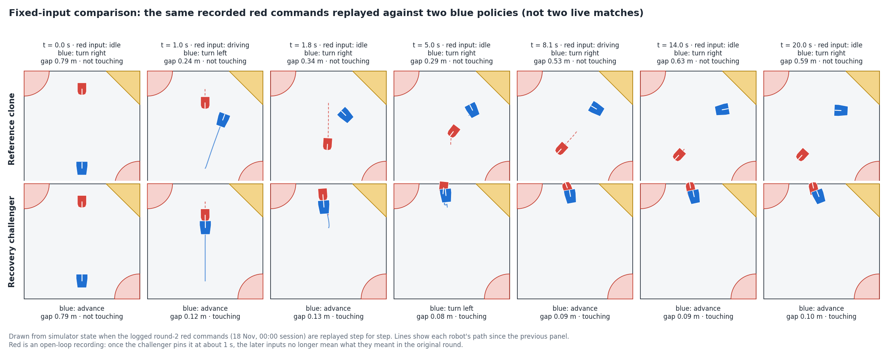

**Figure 11. Fixed-input comparison.** Both rows replay my recorded round-2 red commands, step for step. Top: the reference clone, as it happened. By 1.8 s it has turned away from red; from 8.1 s it is spinning, 0.5 to 0.6 m from a stationary red, to the end. Bottom: the recovery challenger against the same commands. It drives straight at red, is touching it by 1.0 s and stays on it. **This is not two live matches.** Red is a recording and cannot react, so once the challenger has pinned it against the top wall, the later recorded commands no longer mean what they meant when I typed them. The comparison shows that blue now follows; it does not show how a match would go.

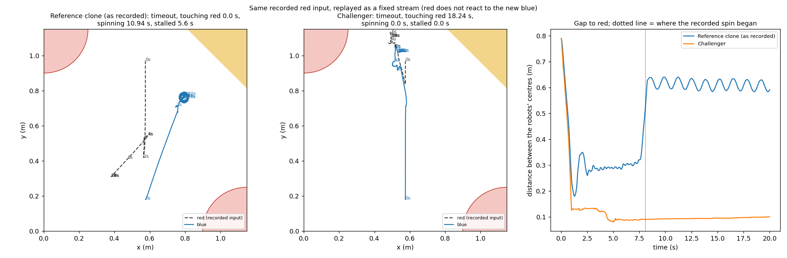

**Figure 12. The same comparison as paths and distance.** Right-hand panel: the gap between the robots over time. The reference clone (blue line) lets the gap grow to 0.6 m when red leaves at about 8 s and then oscillates as it spins. The challenger (orange) closes to contact in the first second and holds it.

| On my recorded round | From the start | From the saved state just before the spin |
|---|---|---|
| Reference clone | Spins for 10.9 s, never touches red | Spins for 10.9 s, never touches red |
| First challenger | Touches red at 1.0 s, no spin | **Never touches red, stalled 11.0 s** |
| Recovery challenger | Touches red at 1.0 s, no spin, no stall | Touches red at 1.3 s, no spin, no stall |

*Fixed-input replay. Every row is a timeout: nobody falls.*

### 6.6 Matched benchmark

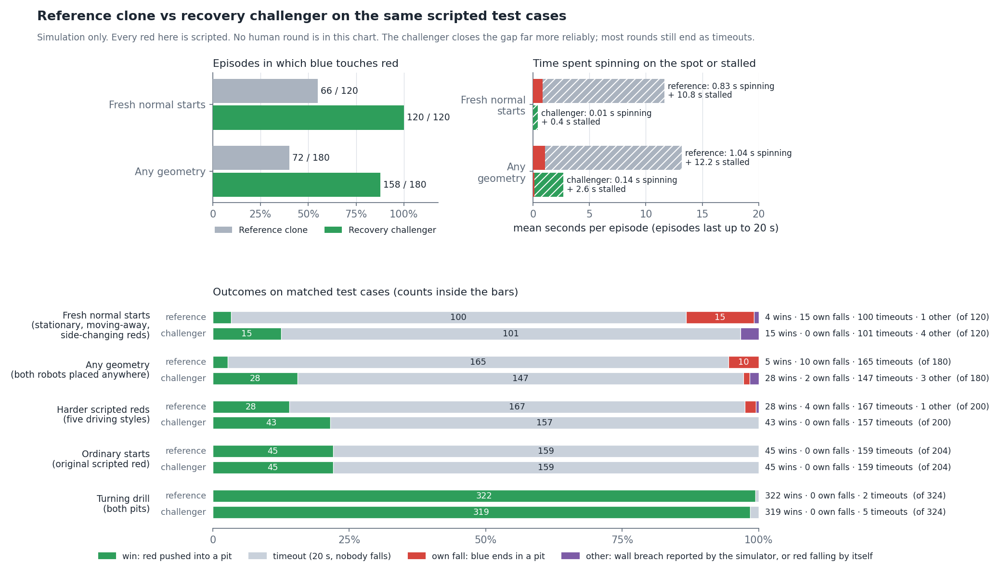

**Figure 13. Reference clone against recovery challenger on the same scripted test cases.** Top left: how often blue reaches red at all. Top right: seconds per round spent spinning or stalled. Bottom: how each round ended, with counts. The challenger reaches red in every fresh-start round and nearly stops stalling, falls in less, and keeps the turning drill. Look at the grey: most rounds are still timeouts.

*Simulation; scripted reds; test cases only; same starts and seeds for both policies.*

| Test set | Rounds | Reference clone: wins / own falls / timeouts | Recovery challenger: wins / own falls / timeouts |
|---|---|---|---|
| Fresh normal starts (red stationary, moving away, changing sides) | 120 | 4 / 15 / 100 | 15 / 0 / 101 |
| Any geometry | 180 | 5 / 10 / 165 | 28 / 2 / 147 |
| Harder scripted reds, five styles | 200 | 28 / 4 / 167 | 43 / 0 / 157 |
| Ordinary starts, original scripted red | 204 | 45 / 0 / 159 | 45 / 0 / 159 |
| Turning drill, both pits | 324 | 322 / 0 / 2 | 319 / 0 / 5 |

| | Reference clone | Recovery challenger |
|---|---|---|
| Reaches red, fresh normal starts | 66 of 120 | 120 of 120 |
| Reaches red, any geometry | 72 of 180 | 158 of 180 |
| Spinning, per 20 s round (fresh) | 0.83 s | 0.01 s |
| Stalled, per round (fresh) | 10.8 s | 0.4 s |
| Median time to first touch (fresh) | 1.7 s, when it happens | 1.1 s |

Rows that do not add up to the round count are rounds that ended another way: the simulator reported a robot pushed through the outer wall (7 of the challenger's 1,074 test rounds), or red fell in with no recent contact. Neither is counted as a win or a loss. The wall breaches are an existing physics limit that only a blue which pins red against a wall ever reaches.

### 6.7 Live sessions since the fix

*Simulation, live human input.* After the fix I played against the recovery challenger in two sessions on 18 November. Those logs are in the repository. They were replayed for this document; they have not been through the benchmark scripts, and there are no notes on what I was trying to do in each round.

| Session | Rounds in the log | What the log and its replay show |
|---|---|---|
| Reference clone, 00:00 | 2 | Both timeouts. Round 1: touching red for 2.6 s. Round 2: never touches red; the spin. |
| Recovery challenger, 09:58 | 9 | Blue touched red in every round, first contact between 0.68 and 1.10 s. No spin (largest one-way rotation 74°). **2 rounds ended with red in a pit** (at 7.2 s and 2.7 s), 1 ran to a 20 s timeout with 16.2 s of contact, and I reset the other 6 before they ended. |
| Recovery challenger, 20:26 | 2, neither finished | Round 1: contact at 0.72 s, reset at 4 s. Round 2 did not replay faithfully (blue's choices match the log at only 637 of 918 decisions), so nothing is drawn from it. |

In the two rounds where red fell, blue was in contact during the final half second, and red does not fall when the same commands are replayed against a blue that never moves. That is the same attribution rule the benchmarks use. It cannot tell a push from me steering into the pit under pressure, and those rounds have not been reviewed by eye. Every replayed round except the last reproduces the logged blue exactly.

### 6.8 What this does not show

- **Reaching red is not winning.** The challenger closes the gap far more reliably. It turns contact into a win only when the line it happens to push along ends in a pit: 13% of fresh rounds and 22% against the harder reds. In a typical round it reaches red in about a second and then stays against it for about 15.
- **It is a chaser, not a strategist.** It has no notion of where the pits are relative to red.
- **The copy is not perfect.** From any geometry it reaches red in 158 of 180 rounds where its teacher reaches 180 of 180, and it fell in twice where its teacher never did.
- **Some test sets were reused.** Four of the test sets had already been run for the first challenger before the second was trained. The any-geometry test cases and the saved-state check were new.
- **Two live sessions are an observation, not a benchmark.**
- **It is not a robot controller.** It reads simulator truth.

Evidence: local `artifacts/live-spin-diagnosis-2026-11-18.md` · local `artifacts/reactive-recovery-handoff-2026-11-18.md` · local `artifacts/reactive-recovery-comparison.json` · [regression case](../../config/regression_cases/live_spin_2026_11_18.json)

## 7. 20 November 2026: Wi-Fi integration failures and the decision to reuse ELRS

The day before the competition was the first day the laptop, the firmware and the powered robot were all
used together. It started with a PC driving the robot over Wi-Fi and ended with the Wi-Fi build off the
robot, an unexplained power fault, and a different plan for how the laptop should reach the motors. This
section records what happened in order, what was measured, what is still not known, and why the plan
changed. Nothing in it has been tidied up afterwards.

Four labels are used in this section and in the [status table](#78-where-each-piece-stands) at its end:

- **Demonstrated on hardware**: seen on the real robot, by me.
- **Tested in software**: real code against a mocked board, synthetic frames or the simulator.
- **Proposed**: designed or investigated on paper, not built or not powered.
- **Blocked / unverified**: cannot be claimed, with the reason.

### 7.1 The architecture I tried first

Written on 19 and 20 November. The RadioMaster keeps arming and override; the laptop sends drive
commands straight to the robot over the ESP32's own Wi-Fi access point.

```
ATTEMPTED ARCHITECTURE (19-20 November): implemented, driven once, then withdrawn as the default

  Laptop (keyboard client; later the policy)              RadioMaster Pocket
          |                                                       |
     Wi-Fi, UDP                                               ExpressLRS
          v                                                       v
  ESP32-C3 soft access point  ----  same ESP32-C3  <----  ELRS receiver (UART)
                                         |                (ARM switch, RADIO/PC switch, sticks)
                                    firmware: who has control? stop on disarm,
                                    radio loss, or 250 ms without a PC command
                                         v
                                      DRV8833
                                         v
                                       Motors
```

One microcontroller runs two 2.4 GHz radios' worth of work here: its own Wi-Fi access point, and the UART
from the ELRS receiver sitting a few centimetres away. Both are powered from the same small regulator as
the motors' logic.

### 7.2 What happened, in order

| # | When | What happened | Evidence |
|---|---|---|---|
| 1 | from 10 Nov | **Manual RadioMaster control worked** on the original drive sketch | Demonstrated on hardware (no saved log or video) |
| 2 | 19 Nov; driven early on 20 Nov | **USB handoff implemented and physically demonstrated.** A new sketch, `ELRS-Handoff-Bench`, adds an ARM switch and a RADIO/PC switch. With the robot on a USB cable I drove it from the laptop keyboard and switched control in both directions | Demonstrated on hardware (my report; the sketch's hash is pinned; the client as used is snapshotted) |
| 3 | 20 Nov, from 12:48 | **Wi-Fi handoff implemented and initially demonstrated.** The same sketch plus a soft access point and UDP. Untethered keyboard driving worked | Demonstrated on hardware, then unstable. The client's log shows the PC as active source for about 266 s |
| 4 | 20 Nov, afternoon | **Wi-Fi testing coincided with increasingly unstable battery operation.** Link interruptions; the robot stopped responding until disarmed and re-armed; motor jitter | My observation. The log shows 12 latched stale-command faults and 56 status dropouts, the longest 4.7 s |
| 5 | 20 Nov, 14:34 onward | **The ESP32 and the ELRS receiver began restarting repeatedly**, ending in a restart loop | My observation. Three restarts are in the log (14:34:12, 14:34:40, 14:41:27); the loop came after the log ends |
| 6 | 20 Nov | **The left motor moved unintentionally during start-up and reset** | My observation. Not in any log. The same wheel moved under an IMU-only sketch on 17 November (section 2) |
| 7 | 20 Nov | **Measurements showed the supply collapsing** in the failing condition: about 3.0 V at the buck converter's input and 1.0 V at its output, against 5.4 V at the unloaded battery | Reported multimeter readings; conditions not recorded |
| 8 | 20 Nov | **Several batteries and a replacement converter were tried** without settling the cause | My report |
| 9 | 20 Nov, about 21:57 | **Battery-powered operation came back** after I changed the battery and uploaded `ELRS-Handoff-Bench.ino` again. The robot starts on battery alone, the receiver stays up, and I can drive it from the RadioMaster | Demonstrated on hardware (no saved log). The IDE's last build of that sketch is at 21:56:56 and matches the repository file |
| 10 | same night | **Two things changed at once**, so which one fixed it is unknown: a different battery, and firmware with no Wi-Fi | Unresolved |
| 11 | 20 Nov, night | **The preferred plan changed** to relaying PC commands through the existing ELRS transmitter, if the hardware allows it | Proposed. Investigated on paper only (7.5) |
| 12 | 20 Nov, night | **The Wi-Fi build was kept** as an experimental route, with its tests and its failure record, not deleted | In the repository: `ELRS-Handoff-WiFi/` |

Risk R6 in the project handbook, written in September, reads "ESP32 brownout under stall" with the symptom
"resets during acceleration". The fault that arrived was a cousin of it: resets, but in the cases the log
caught, with the motors at rest.

### 7.3 The measurements, and what they do and do not show

| Where | Condition | Reading (multimeter, reported) |
|---|---|---|
| Battery terminals | no load | about 5.4 V |
| Buck converter input | one failing load condition | about 3.0 V |
| Buck converter output | the same condition | about 1.0 V |
| Both converter terminals | USB powering the ESP32, battery disconnected | about 4.8 V |

**What they establish.**

- In the failing condition the microcontroller and the receiver had about 1 V. Neither can run on that.
  The restarts need no further explanation than the supply.
- The converter was not the only thing losing voltage. Its own input was at 3.0 V, so either the cells
  could not hold up under that load or a couple of volts were being dropped in the switch, connectors or
  wiring before the converter.
- With USB plugged in and the battery out, 4.8 V appears on **both** sides of the converter. USB power
  reaches the converter's output and passes backwards through it. With USB and battery both connected, the
  two supplies are joined through the converter.

**What they do not establish.**

- **The root cause.** A discharged or tired battery, a high-resistance connection, a converter outside its
  operating range, too much load, or a combination all fit these four numbers.
- **That Wi-Fi caused it.** The Wi-Fi build draws more current in bursts when it transmits. That may have
  exposed a supply that had no margin. It is a hypothesis: I did not measure current, and I did not run the
  Wi-Fi build on a supply known to be good.
- **That the spare batteries or the replacement converter were sound.** Swapping them without a change in
  behaviour does not clear them.
- **Whether running USB and battery together is safe.** The reverse path exists; what flows through it was
  not measured.
- **How much margin the working baseline has.** It runs tonight. How close it is to the same collapse is
  unmeasured.

I did not record which battery gave which reading, the load at the time, or whether the 5.4 V, 3.0 V and
1.0 V readings were simultaneous. Those omissions are why this section says "about" and "one failing
condition".

**What the client's log adds.** The laptop logged every status line the controller sent between 12:48 and
14:48. It shows three firmware restarts, each with the motors reported at zero just before, and each
followed by the firmware coming back disarmed and refusing to drive because the ARM switch was still on.
Whenever the radio link was up, the receiver reported 98 to 100 % link quality. So in the two hours that
were logged, the restarts were not obviously tied to driving, the boot interlock did its job, and there is
no sign that Wi-Fi was degrading the ELRS link. None of that says why the supply collapsed.

### 7.4 Why Wi-Fi looked right, and why it was the wrong default

**Why it was attractive.** No extra hardware: the ESP32-C3 already has the radio. No tether. The laptop
gets status back over the same link, so the keyboard client can show who has control and why. The command
format was the one already proven over USB. It took a day to write and passed 133 mocked tests.

**Why two radios on one board added complexity.** The Wi-Fi access point and the ELRS receiver share the
2.4 GHz band, a few centimetres of board, one microcontroller's attention and one regulator. Each of those
is a way for one link to disturb the other, and each needs its own test: channel choice, transmit power,
the receiver's link quality with the access point running, loop timing, and supply current during
transmit bursts. I ran none of those in isolation before driving.

**Why radio-control reliability matters more than a clever transport.** The RadioMaster is how I arm, how
I take over, and how I stop the robot. A transport for PC commands is only worth having if it leaves that
path at least as dependable as it was. A robot that restarts in the arena has no control path at all,
whatever the laptop is doing.

**Why a pass on USB power says nothing about battery power.** Every earlier success with new firmware,
including the USB handoff demonstration, had a USB cable attached. The cable is a second power supply.
The 4.8 V reading shows it feeds the whole regulated rail and reaches the battery side too. So a tethered
test could not have exposed a weak battery path, and the first test without the cable was also the first
test of the supply on its own. Software checks could not see this either: the mocked board has no
battery.

**Why a working fallback had to be kept, that night.** With hours left, the choice was between
understanding the fault and having a robot that drives. I restored a build that had already been
demonstrated, confirmed it drives on battery, and stopped changing things on the robot. The original
RadioMaster-only sketch is still on disk, byte for byte, behind it.

### 7.5 The revised plan

```
REVISED TARGET ARCHITECTURE (decided 20 November): NOT built, NOT verified

  Logitech C525
       v
  Laptop: arena calibration, ArUco tracking of my robot, opponent tracking,
          19-value observation, trained policy -> throttle / steer
       |
       |  an input the transmitter actually accepts (see below: none is verified)
       v
  RadioMaster Pocket: mixer selects STICKS or PC with a physical switch; ARM stays a physical switch
       |
   ExpressLRS: the link that already works on battery
       v
  ELRS receiver -> ESP32-C3 (no Wi-Fi) -> DRV8833 -> Motors
```

The robot would carry one radio, not two, and run firmware that has already driven on battery. The cost
is that the PC-or-pilot decision moves out of firmware I tested against a mocked board and into the
transmitter's mixer, which I have not tested at all, and the firmware loses the ability to tell a PC
command from a stick.

The routes, in the order I will try them:

| Route | Path | Status |
|---|---|---|
| A. USB handoff | Laptop → USB → ESP32-C3 | **Demonstrated on hardware** (normal path only). Tethered, so useful for checking commands and movement, not for a match. Running USB and battery together needs the reverse-power question answered first |
| B. Pocket relay | Laptop → transmitter input → ELRS → robot | **Proposed.** Desk investigation only: [feasibility note](../elrs-relay-feasibility.md). USB joystick mode is output-only; USB serial cannot be a trainer input in released EdgeTX; a Lua script over USB serial (about 20 updates a second) and PPM into the trainer jack (pinout and voltage tolerance undocumented) are possible and unproven |
| C. Second ELRS transmitter | Laptop → own ELRS module → robot | **Rejected for now.** ELRS allows one active transmitter per binding, a bare ESP32-C3 has no ELRS radio chip, and the Pocket would lose its authority |
| D. ESP32 Wi-Fi | Laptop → Wi-Fi → ESP32-C3 | **Experimental.** Implemented, driven, then unstable. Not to be made the default until the power fault is understood and the acceptance test passes on battery |

### 7.6 How a hardware fault changed the software

- **Where the handoff lives.** In the attempted design the firmware arbitrates: token, neutral-first,
  stale-command latch. In the target design the transmitter's mixer arbitrates and the firmware sees only
  "radio". The tested arbitration code stays useful for routes A and D only.
- **A movement check before any autonomy.** `scripts/motion_check.py` runs one short, fixed tactic sequence
  (stop, advance, stop, turn left, stop, turn right, stop, reverse, stop) at 40 % of the simulator's
  command scale, in the simulator and, when I confirm it, on the robot through the proven USB path. It
  records every command with its duration, source and time, and compares the direction of each move. It
  refuses to start a floor run until five wheels-raised checks (stop, disarm, manual takeover, PC link
  loss, radio loss) have passed on the same firmware that day. *Tested in software* against the real bench
  sketch on a mocked board; **not yet run on the robot**.
- **Live shadow lost its IMU source.** The policy's first six inputs are gyro and accelerometer readings.
  The only firmware that sends them is built on the Wi-Fi sketch. The baseline now on the robot sends
  none, so a real 19-value observation cannot be assembled tonight without flashing something else, and I
  am not inventing the missing six values.
- **Vision had to stop assuming every marker is visible.** The single-frame pose code gave up whenever markers disagreed or vanished. With nine markers that each appear intermittently, a new tracker takes the largest consistent set, names the ones it rejects, and labels every pose *measured*, *predicted*, *stale* or *lost*; only the first two may feed the policy. A click-selected tracker follows the unmarked opponent and refuses to give a position while the robots touch. *Tested in software* on rendered frames (27 tests); **never run on the real camera**, and the marker layout is still unmeasured.
- **Evidence tooling.** `scripts/handoff_log_summary.py` turns a client log into restarts, dropouts and
  latched faults. It exists because the first pass at "what happened this afternoon" was memory.

### 7.7 What I would do differently

1. Measure the battery rail under load, without USB, before adding anything that draws more current.
2. Change one thing at a time on the last day. The recovery changed two, and now neither can be credited.
3. Save the evidence as it happens: the meter readings above were typed from memory hours later.
4. Treat "works on the bench cable" as a different claim from "works on the battery".

### 7.8 Where each piece stands

| Piece | Demonstrated on hardware | Tested in software | Proposed | Blocked / unverified |
|---|---|---|---|---|
| RadioMaster drive, battery only, on `ELRS-Handoff-Bench` | **Yes**, 20 Nov night (no saved log) | Mocked-board tests pass | | Margin of the power supply; cause of the earlier collapse |
| USB handoff (route A) | **Yes**, normal path: PC drives, both handoff directions | 60 mocked tests | | Failure cases on hardware; USB and battery together |
| Wi-Fi handoff (route D) | Drove untethered, then restarts and dropouts | 133 mocked tests | | Not a default. Needs the power fault understood and the acceptance test passed on battery |
| Cause of the restarts | Supply collapse measured in one failing condition | | | Root cause; whether Wi-Fi current was the trigger |
| Cause of the recovery | | | | Battery change and firmware change were made together |
| Left wheel moving at reset | Seen again | | Strapping-pin explanation | Not measured |
| Pocket relay (route B) | | | Feasibility note; two candidate inputs | Nothing powered; trainer-jack pinout and voltage unknown |
| Movement check, simulator against robot | | Simulator reference; 53 tests incl. the real sketch on a mocked board | | Not run on the robot |
| Multi-marker chassis tracking with measured / predicted / stale / lost states | | 16 tests on rendered frames (error up to 2.5 mm measured, 3.8 mm predicted, ideal camera) | | Real camera; the nine markers' dictionary, IDs, sizes and positions are unmeasured |
| Rear marker as a pose source | | Rendered frames only | | Depends on a camera position that is derived, not measured; whether the rear marker is ID 8 |
| Click-selected opponent tracking | | 11 tests on rendered frames | | Real lighting; identity through a long push (it reports *lost* and needs a re-click) |
| Live shadow from real camera and real IMU | | Fixture runs only | | **Blocked**: baseline firmware sends no IMU data; markers unmeasured; no calibration saved |
| Learned policy driving the real robot | | | | **Blocked.** No verified untethered command path, no verified real observation, no hardware-tested takeover with the policy in the loop |

**After the competition (22 November).** This table is the state on the night of 20 November and is left as written. Three rows moved on 21 November, and none of the blocked rows was unblocked. *RadioMaster drive, battery only:* the robot was driven through the competition this way. *Multi-marker chassis tracking:* it met the real camera for the first time and did not hold a track; the markers are still unmeasured. *Live shadow* and *learned policy driving the real robot:* still blocked, now with a logged example of an incomplete observation. None of the 20 November electrical questions (the restarts, the recovery, the left wheel) was investigated further. See [section 10](#10-competition-day-21-november-2026).

Evidence: the tracked [competition evidence note](../competition-2026-11-21-evidence.md) preserves the later machine-recorded context; the 20 November source records remain local at `artifacts/integration-2026-11-20/evidence.md`, `artifacts/integration-2026-11-20/wifi-session-log-summary.txt`, and `logs/handoff-wifi.txt` · [relay feasibility note](../elrs-relay-feasibility.md) · [bench sketch](../../ELRS-Handoff-Bench/ELRS-Handoff-Bench.ino) and [its README](../../ELRS-Handoff-Bench/README.md) · [Wi-Fi sketch](../../ELRS-Handoff-WiFi/ELRS-Handoff-WiFi.ino) and [its README](../../ELRS-Handoff-WiFi/README.md) · [movement check](../../scripts/motion_check.py) · [test playbook](../autobots-test-playbook.md)

---

## 8. What is verified, and where

These are separate milestones. None of them is evidence for any other. Rows marked *20 Nov* were added or changed in the second edition; the integration work has its own, finer table in [7.8](#78-where-each-piece-stands). Rows and notes marked *21 Nov* were added in the third edition, after the competition. For those rows the "Hardware" column includes what I saw at the event without recording it; each says which.

| Milestone | Hardware | Simulation | Historical footage | Synthetic / mocked | Planned |
|---|---|---|---|---|---|
| Manual drive from the RadioMaster | **Yes** (no saved log or video). *20 Nov:* on battery alone, on the handoff sketch, after the recovery | | | | |
| *20 Nov:* laptop keyboard driving over USB, with RadioMaster arming and handoff | **Yes**, normal path only | | | 60 mocked-board tests | Failure cases on hardware |
| *20 Nov:* laptop keyboard driving over Wi-Fi | Worked, then restarts and dropouts; withdrawn as the default | | | 73 mocked-board tests | Acceptance test on a supply known to be good |
| *20 Nov:* battery supply holds up under load | **No**: collapse measured in one failing condition; cause unknown | | | | Rail measurement under load |
| *20 Nov:* same commands, same direction of movement in simulator and on the robot | Not run | Reference trace | | 53 tests, incl. the real sketch on a mocked board | Wheels-raised run, then floor |
| *20 Nov:* PC commands relayed through the transmitter | | | | | Desk investigation only |
| IMU reads orientation (three flips) | **Yes**, as a separate bench test (log not saved) | | | | |
| Merged firmware: source switch + IMU telemetry | Not flashed; superseded by the handoff sketches | | | Compiles; mocked host tests pass | A telemetry build exists on the Wi-Fi sketch, never flashed |
| Cause of the left-wheel incident | Unconfirmed; seen again on 20 Nov | | | | Multimeter check |
| Blue policy chases and pushes | | **Yes**: scripted benchmarks, fixed-input replay, live sessions | | | |
| Floor mapping from an angled camera | | | **Yes**, approximate (23 mm at one held-out landmark; graded WEAK) | Yes | Fresh calibration on the day |
| Tracking unmarked robots | | | **Yes**, offline, 24 s clip | Rule tests | Live version needs an empty-arena image |
| ArUco pose with height correction | | | No markers present | **Yes**. *20 Nov:* plus multi-marker tracking with explicit states and a clicked-opponent tracker, 27 tests | *20 Nov:* markers fitted; measure them, then the real camera |
| Camera + IMU together | | | | | Not built |
| Learned policy driving the real robot | | | | | **Blocked.** A tethered keyboard link exists; no verified untethered path, no verified live observation. *21 Nov:* not attempted at the competition |
| *21 Nov:* competing under manual control | **Yes**, reported: driven from the RadioMaster through the competition. No match record, photo or video | | | | |
| *21 Nov:* arena mapping from my own camera at the event | **Yes**, logged: four corners clicked, hazards placed, alignment confirmed by me. Graded WEAK for want of a check point | | | | A check point; a tape-check of the arena |
| *21 Nov:* detecting my robot's markers at arena distance | **No**, reported: unreliable on the arena floor, possible at 20 to 30 cm from the camera. Logged: intermittent decodes | | | Works on rendered frames | Measure pixel size and detection rate against distance |
| *21 Nov:* pose and continuous localisation of my robot | **No**, logged: decoded markers rejected (placeholder size), markers disagreeing by about 155 mm (placeholder positions), no track held | | | Works on rendered frames | Measure the markers into the configuration |
| *21 Nov:* passive wedge gets under opponents and displaces them | **Yes**, reported. Not recorded | | | | |
| *21 Nov:* wedge takes impact damage in place of the electronics | **Yes**, reported, at least one engagement with a spinner. Not photographed | | | | A replaceable wedge |
| *21 Nov:* robot stays mobile on a cluttered floor | **Not always**, reported: occasionally stuck with something trapped underneath. Cause unknown | | | | Investigate the underside |

## 9. Who did what

I directed this project and used coding agents heavily for implementation and experiments (Claude Code throughout; a Codex session appears in the 14 November simulator work). The split below is what the repository supports.

| Work | Who | Evidence |
|---|---|---|
| Driving red in the recorded live simulator rounds, and noticing the spin | Me | Session logs; the diagnosis was written in response to my report |
| The IMU bench test and its result | Me | Recorded in the firmware notes as my bench result; no log saved |
| Driving the physical robot | Me | Firmware review refers to the sketch I drive with; no log or video |
| Setting each experiment's question, constraints and stopping rules; the firmware safety rules | Me | The handoff reports answer briefs I wrote and note where an agent went beyond them |
| Supplying the arena floor drawing and choosing the test footage | Me | Footage handoff |
| Every upload to the robot, all bench and battery testing on 19 and 20 November, the multimeter readings, fitting the markers, and the decision to drop Wi-Fi as the default | Me | My brief of 20 November; local evidence: `artifacts/integration-2026-11-20/evidence.md` |
| Simulator code, training and evaluation scripts, the experiments in section 5, the diagnosis and fix in section 6 | Coding agents, under my direction | Dated handoff reports in `artifacts/`, each with a code patch |
| Vision overlay tool, footage calibration, tracker | Coding agents, under my direction | Vision handoffs |
| Merged firmware, host tests, firmware review (nothing flashed) | Coding agent | Firmware review |
| Handoff sketches (USB, Wi-Fi, telemetry), their host tests, the PC client, the movement check, the log summary, the transmitter relay investigation (no agent flashed, powered or drove the robot) | Coding agents, under my direction | Sketch READMEs; `tests/`; [relay note](../elrs-relay-feasibility.md) |
| Section 7 and the second edition's updates | Drafted by a coding agent from my brief of 20 November, the client log and the files on disk | Local evidence: `artifacts/integration-2026-11-20/evidence.md` |
| This document's first edition and its figures | Drafted by a coding agent from the evidence in Appendix C | `tools/` in this folder |
| Setting up the camera, calibrating the arena, deciding to drive manually, and driving every match on 21 November | Me | My account of the day; [the laptop's log](../competition-2026-11-21-evidence.md) for the calibration and tracking |
| The Command Centre used that morning | Coding agents, under my direction, in the two nights before | [Changelog](CHANGELOG.md), entries for 21 November |
| Section 10 and the third edition's updates; the reading of the 21 November log and the marker-size estimate | Drafted by a coding agent from my written account of the competition and the files on the laptop. The agent was not at the event and measured nothing | [Evidence note](../competition-2026-11-21-evidence.md) |

**Not recorded in the repository, so not claimed here:** the chassis design history (the CAD file is present; how it was designed, printed and assembled is not documented), who wrote the 10 November drive sketch and how, and how the physical timing measurements were taken. I will fill these in from my own records.

## 10. Competition day (21 November 2026)

Capri V1 took part in the BEEES antweight competition on 21 November 2026. I drove it by hand. This section records what the day showed, what it did not, and what is still unexplained.

**How to read this section.** Almost nothing was recorded at the event. There are no photographs, no videos and no match notes, so most of what follows is *reported*: my own account, written afterwards. The exception is the laptop: the Command Centre logged a fifteen-minute session that morning, and that log is quoted in full in the [evidence note](../competition-2026-11-21-evidence.md). Where a statement rests on the log it is marked *logged*. Match results, rankings and placements were not written down, so there are none here, and none have been reconstructed.

### 10.1 What the day showed

| | Result | Basis |
|---|---|---|
| **Demonstrated at the competition** | | |
| Arena mapping | The Command Centre established the arena geometry from the overhead camera | Logged, reported |
| Manual ELRS operation | The robot competed, driven from the RadioMaster Pocket | Reported |
| Passive wedge effectiveness | The wedge got underneath many opponents and lifted or displaced them | Reported |
| Sacrificial wedge | In at least one engagement with a spinner the wedge took the damage and the electronics did not | Reported |
| **Not achieved or not demonstrated** | | |
| Reliable full-arena ArUco localisation | Markers were not reliably detected with the robot on the arena floor, and no pose was held | Reported, logged |
| Physical autonomous operation with the learned policy | Not attempted in any match | Reported; repository state |
| Wi-Fi motor control with the policy in the loop | Not attempted. The Wi-Fi build was not on the robot | Repository state |
| **Unresolved** | | |
| Why marker detection was poor at distance | A likely explanation exists (10.4); it was not measured | Hypothesis |
| Why the robot occasionally became immobilised | Not investigated yet | Reported |
| The Wi-Fi and electrical instability of 20 November | Not investigated further; section 7 stands as written | |

### 10.2 The original ambition, and what replaced it

The aim for this competition was to run the robot autonomously: camera, tracking, the learned policy, and a command link to the motors. That did not happen. On the day I chose not to attempt it and drove with the RadioMaster Pocket over the existing ExpressLRS link.

That was a decision, made because the tracking was unreliable. It was not the result of trying the policy on the robot and watching it fail. The policy has still never controlled the physical robot, in a match or anywhere else, so the competition is not evidence about the policy in either direction.

One clarification about the policy itself, which matters for anyone reading this as "the reinforcement learning did not work on the day". The checkpoint that would have been used is not a PPO-trained policy. As section 5 describes, PPO never learned the pushing task; the working simulator policy is a behaviour-cloned copy of a scripted pursuit controller, saved in a PPO container ([audit](../policy-observation-schema.md)). It also reads positions that only the simulator can supply exactly. So even with perfect tracking, autonomy on the day would have needed the remaining gaps closed too: a live inertial source, a measured command mapping, and a command link that had been proven on battery.

### 10.3 The camera calibration worked

*Logged and reported.* At the event the camera was placed so that it could see the whole arena. In the Command Centre I clicked the four arena corners on the 1280 × 720 picture, placed the two pits and the flipper, and saved the calibration at 10:35. The arena sizes came from the design drawing (1150 mm square, R250 pits), not from typed measurements. The tool compared the live picture with the stored one, I checked that the drawn outline sat on the floor edges, and confirmed the alignment at 10:35:42.

This is a real, positive result: the first time the arena mapping ran on my own camera at a real arena, and it did what it was built to do.

Two limits on that claim, both from the log:

- The tool graded the fit **WEAK**, because I did not click a fifth point for it to check against. Four points always fit exactly, so nothing independent confirms how accurate the mapping was. The outline looked right to me; that is a visual check, not a measurement.
- The live profile has no lens model, and I did not tape-check the arena against the drawing.

**Mapping the arena is not the same as locating the robot.** The calibration turns a pixel into a floor position. It says nothing about whether the software can find my robot in the picture. That is the next subsection, and it is where the day went wrong.

### 10.4 Marker tracking failed at arena distance

*Reported.* During development the camera detected the ArUco markers when I held the robot fairly close to it. At the competition the camera had to be further away to take in the arena. With Capri on the arena floor, the software could no longer reliably identify its markers. When I picked the robot up and held it about 20 to 30 cm from the camera, detection came back. At the distance that mattered, it did not work.

*Logged.* The Command Centre's log for 10:31 to 10:46 that morning fills in some of what the tracker was doing. It does not record where the robot was at each moment, so it cannot be lined up with "on the floor" or "in my hand".

- Marker IDs 0, 1, 2, 3 and 5 were each decoded at some point. Detection was intermittent, not absent.
- Decoded markers were then **rejected as the wrong size**: "measures 17 mm but is configured as 40 mm". The 40 mm in the configuration is the placeholder that section 4 describes. The markers were never measured.
- When more than one marker was accepted, they **disagreed about where the robot's centre was** by about 155 mm, against a limit of 20 mm. The marker positions on the chassis are placeholders too.
- The tracker never held a pose. It was reacquired after gaps of 15 s, 118 s and 253 s and lost again within about a second each time.
- The one round I started from the Command Centre lasted 1.4 s in MANUAL and recorded "no observation" six times: IMU missing, own pose missing, opponent missing.

So there were two problems stacked on each other, and they should be kept apart:

| Stage | What happened | Basis |
|---|---|---|
| Camera calibration | Succeeded | 10.3 |
| Raw marker detection at arena distance | Failed to be reliable | Reported; consistent with the log |
| Pose estimation from the markers that were decoded | Not established: the marker configuration was unmeasured | Logged |
| Continuous localisation | Not established | Logged |

**The most likely explanation for the detection failure** is that the printed markers occupied too few pixels in the image, together with the limits of the Logitech C525 and its optics. I believe this is right. It is a diagnosis, not a measured root cause: I did not record marker pixel dimensions, exposure, focus, or the detector's raw output.

One estimate can be made after the fact from the saved calibration. The 1150 mm arena edges span between 577 and 760 pixels in the calibrated picture, which is 0.50 to 0.66 pixels per millimetre at floor level. The printed marker size was never recorded; the tracker's own estimates for the markers it decoded were 17 to 28 mm. A marker of that size would be roughly 9 to 19 pixels across, or 1.5 to 3 pixels for each of its six cells. That is very little for a detector to work with, and it is consistent with the diagnosis. It does not prove it, because the estimate leaves out marker height, lens distortion, focus, exposure and blur. The working is in the [evidence note](../competition-2026-11-21-evidence.md#3-how-large-a-marker-was-in-the-picture).

What I would want before calling the cause settled is in [the roadmap](../roadmap.md#2-close-out-the-v1-unknowns-first): markers of known sizes at measured distances, with pixel size and detection rate written down.

The consequence was simple. Without a dependable position for my own robot, the autonomy pipeline had no trustworthy observation of the real world, and there was nothing sound for the policy to act on.

### 10.5 What else stood between the robot and autonomy

Tracking was the failure I met on the day. It was not the only gap, and removing it would not have been enough. These were all open before the competition and are still open:

- The left wheel moving at reset and under an IMU-only sketch, unexplained (sections 2 and 7).
- The ESP32 and receiver restarts during the Wi-Fi tests of 20 November, with a supply collapse whose root cause is not identified. Wi-Fi was running at the time; it has not been shown to be the cause, and I am not claiming it was.
- An intermittent Wi-Fi control link in those same tests.
- A power path that is not understood, including USB reaching the battery side of the converter.
- No verified transmission of an autonomous command from the laptop to the robot. A keyboard over USB is the only PC input the motors have ever followed.
- No real-world validation of the 19-value observation the policy expects. The firmware on the robot sends no IMU data.

### 10.6 The wedge

*Reported.* The passive wedge was the best thing on the robot.

Its leading edge sits very low. That let Capri get underneath many of the robots it met. Once under, driving forward was enough to lift them partly off their wheels or shove them aside, with no active lifting mechanism at all. I consider the wedge geometry the strongest design feature Capri V1 demonstrated.

In at least one engagement with a spinner, the front-left of the wedge took most of the impact damage. The wedge behaved as a sacrificial part, a crumple zone, and the electronics behind it were not damaged. That is an argument for making the wedge deliberately replaceable in a future design. It is not a claim that the wedge is tough: it was damaged, and it would not survive that indefinitely.

There are no photographs of the wedge in action or of the damage. How many opponents it got under, and how many it did not, was not counted.

### 10.7 Mechanical limitations

*Reported.* The low clearance that made the wedge work also cost something. Capri occasionally became stuck or immobilised when something was trapped or wedged beneath it.

I have not worked out the mechanical cause. The things I intend to look at are the geometry of the underside, how the clearance is distributed behind the wedge, wheel placement and traction, how the robot can recover once it is stuck, and how the wedge is mounted. None of these has been examined yet, and none of the possible fixes exists.

I have no failure of the manual-drive firmware or the radio link to report from the event, and nothing was logged either way. I did not record which sketch was on the robot on the day; `ELRS-Handoff-Bench` was the one on it the night before. Battery voltages, restarts and link losses during the event were not logged.

### 10.8 What was captured, against the list I wrote the night before

The second edition of this document ended with a list of things to capture on the day. The repository holds evidence for one of them.

| Planned capture | In the repository? |
|---|---|
| Fresh camera calibration: landmarks clicked, fit and check points, the tool's grade | **Yes**: four corners, no check points, graded WEAK ([evidence note](../competition-2026-11-21-evidence.md#2-the-arena-calibration)) |
| Overlay screenshots from my own camera | One reference picture stored with the calibration on the laptop; not added to this document |
| Photo of the robot as built, top and underside, with a scale reference | No |
| Photo of the camera on its stand and where it sat relative to the arena | No |
| Tape-check of the arena against the drawing | No |
| Whether the camera lens bends straight edges | No |
| Marker dictionary, printed size, height above floor, position on the chassis | Dictionary only (`DICT_4X4_50`); the rest unmeasured |
| Which firmware was on the robot | No |
| Battery voltage at rest before the first match | No |
| Each match: opponent, result, how it ended, duration | No |
| Whether the camera or stand was bumped | No |
| Any IMU log | No |
| Anything that broke, and when | Wedge damage, front-left, against a spinner: reported only |
| Any restart of the robot or loss of the receiver | No |
| What the robot did well and badly as a pusher | 10.6 and 10.7, reported |
| Whether real opponents behaved like any of the scripted reds | Not assessed |

"No" means there is nothing in the repository. Some of these may exist in my own photos or notes; if so they have not been added.

| Match | Opponent | Result | How it ended | Notes |
|---|---|---|---|---|
| *No match records were kept. This table is left empty deliberately.* | | | | |

### 10.9 What the day means for the project

Capri V1 was partly successful. As a machine and as something to drive, it worked: it ran on its battery, it answered the transmitter, it competed, and its wedge did real work against other robots. Against the objective it was built for, operating autonomously, it was unsuccessful. It is neither a complete success nor a failure without value.

The lesson I take from it is the distance between software and synthetic testing and the conditions of a real competition. Every part of the autonomy pipeline had passing tests: on rendered frames, on a mocked board, in the simulator. The camera at arena distance, the battery under load and the arena floor each behaved differently from their stand-ins, and each was met for the first time within about a day of the event.

That is what the next iteration is for. What I am considering is in the [roadmap](../roadmap.md), and what is known to be wrong with V1 is collected in [known issues](../known-issues.md).

## 11. Lessons so far

1. **Measure the task before tuning the learner.** Three training changes failed before a 252-case sweep showed in one table that nothing in the curriculum rewarded turning.
2. **A supervised copy is a diagnostic tool.** Fitting the same network to a hand-written controller separated "blue cannot see enough" from "the learning method cannot find it" in an afternoon.
3. **A clone inherits its teacher's blind spots.** The spin was the teacher's failure first. Check the teacher on the failing case before collecting more data from it.
4. **One live round found what 774 scripted benchmark rounds missed.** Every scripted red closed in, so no test ever asked what blue does when the opponent leaves.
5. **Recorded inputs turn an anecdote into a test.** Because the round replayed exactly, the failure became a regression case that the next two policies were checked against.
6. **Fixed-input replays have a limit.** As soon as the new blue behaves differently, the recorded opponent stops being a meaningful opponent. They show a behaviour changed, not who would win.
7. **Split results by anything symmetric.** Pooling the two pits hid that every early policy only worked at one.
8. **Write the pass rule before the run,** and record it when the rule is amended afterwards.
9. **A passing build says nothing about hardware.** An IMU-only sketch moved a wheel.
10. **A USB cable is a power supply.** Every tethered success hid the state of the battery path. The first untethered test of new firmware was also the first test of the supply.
11. **The control path outranks the transport.** A wireless PC link that costs the reliability of the radio link is a bad trade, however little hardware it needs.
12. **Change one thing at a time when recovering.** A new battery and different firmware went in together, so the fix cannot be attributed to either.
13. **Write measurements down when they are taken.** Four voltages typed from memory, without the conditions, are enough to show a collapse and not enough to find its cause.
14. **Keep the failed branch.** The Wi-Fi build, its tests and its log are still in the repository. They are the only record of how it failed.

Added after the competition (third edition):

15. **Test perception at the distance it will be used.** Markers that decoded in my hand did not decode across the arena. Everything in the autonomy pipeline sat downstream of that, and it was the last thing checked against reality.
16. **A placeholder in a configuration file is a failure waiting for its day.** The tracker rejected real markers because their size and positions had never been measured in. The code was doing its job.
17. **Calibrating the arena, detecting a marker and locating the robot are three results.** The first worked. It would have been easy to report the day as "vision worked" or "vision failed"; neither is true.
18. **Synthetic passes do not add up to a working system.** Rendered frames, a mocked board and a simulator each passed their tests. The camera, the battery and the arena each differed from their stand-in.
19. **The independent fallback is what competed.** Manual ELRS control was kept intact through every experiment, and it is the only reason the robot fought.
20. **The best feature was the simplest.** A low passive wedge did more in the arena than any of the software.
21. **A strength can be the same thing as a weakness.** The low clearance that got under opponents also trapped the robot on debris.
22. **Design the part that gets hit to be replaced.** The wedge absorbed a spinner hit and protected the electronics; it should be a consumable by design.
23. **Take a record-keeper, or be one.** No photos, no videos and no match notes came back from the event. Most of section 10 is memory.

---

## Appendix A. Dated timeline

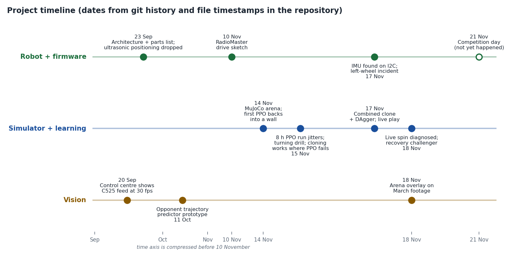

**Figure 14. Timeline.** Three lanes for the three parts. The axis is compressed before 10 November; most of the simulator work happened in five days.

Dates come from git commits and file timestamps in the repository. The timeline figure was drawn for the first edition and stops at 18 November; the table below is current.

| Date | Part | What happened | Source |
|---|---|---|---|
| 22 Mar | Vision | The event recording later used as historical footage was filmed (not by me) | Footage handoff |
| 19 Sep | All | Repository created | git `5dbb565` |
| 20 Sep | Vision | Control centre shows the C525 feed at 1280 × 720, 30 fps, with AprilTag detection | `logs/control_center_20260920_*.log` |
| 23 Sep | Robot | Architecture fixed as vision-first; ultrasonic positioning dropped from the required build; parts list written | git `3b2b96b`, `5057edf`; `hardware/list.md` |
| 11 Oct | Vision | Opponent trajectory predictor prototype (synthetic data, smoke runs) | git `a6fd00d` |
| 3 Nov | All | Architecture commit | git `8b8b7f7` |
| 10 Nov | Robot | RadioMaster drive sketch | `ELRS-Control/` |
| 14 Nov | Simulator | MuJoCo arena with CAD meshes; first PPO runs; policy reverses into the wall; outcome reward makes no difference | `runs/ppo-debug-10k`, `runs/ppo-outcome-10k` |
| 14–15 Nov | Simulator | Curriculum; 8-hour, 5.25M-step run; jitter | `runs/ppo-curriculum-overnight` |
| 15 Nov | Simulator | First recorded human rounds; action-space, previous-action and discount comparisons; alignment sweep; heading ladder; behaviour cloning works; one-pit finding; a runaway calibration job found and fixed | Handoffs dated 15 Nov |
| 16 Nov | Simulator | PPO fine-tuning from the clone loses the skill | Local evidence: `artifacts/clone-finetune-handoff.md` |
| 17 Nov | Simulator | Combined clone with DAgger; harder scripted reds; decision not to train; real-time live play | Local evidence: `artifacts/combined-clone-handoff.md`, `artifacts/overnight-2026-11-17-handoff.md` |
| 17 Nov | Robot | Merged firmware written and host-tested (not flashed); IMU found on I2C; left-wheel incident | Local evidence: `artifacts/firmware-handoff-review-2026-11-18.md` |
| 18 Nov, 00:00 | Simulator | Live round against the reference clone: blue spins | `runs/overnight-2026-11-17/live/` |
| 18 Nov | Simulator | Spin diagnosed; regression case; recovery challenger trained and selected | Local evidence: `artifacts/live-spin-diagnosis-2026-11-18.md`, `artifacts/reactive-recovery-handoff-2026-11-18.md` |
| 18 Nov | Robot | Firmware review, pin table, bench sequence, fallback sketch verified by hash | Local evidence: `artifacts/firmware-handoff-review-2026-11-18.md` |
| 18 Nov | Vision | Overlay tool on synthetic frames; then calibrated and tracked on the March footage | Vision handoffs |
| 18 Nov, 09:58 and 20:26 | Simulator | Live sessions against the recovery challenger | `runs/reactive-recovery-2026-11-18/live/` |
| 19 Nov | Robot | Standalone handoff sketch (ARM and RADIO/PC switches) and keyboard client written and tested on a mocked board | `ELRS-Handoff-Bench/`, `tests/test_handoff_bench.py` |
| 20 Nov, early | Robot | Handoff sketch uploaded; laptop keyboard drives the robot over USB; control handed over in both directions | My report; `artifacts/code-snapshots/handoff-usb-tested-2026-11-20/` |
| 20 Nov, 12:48–14:48 | Robot | Wi-Fi handoff sketch on the robot: untethered keyboard driving, then stale-command latches, dropouts and three logged restarts | `logs/handoff-wifi.txt` |
| 20 Nov, afternoon and evening | Robot | Restart loop on battery; left wheel moving at reset; supply measured at 3.0 V in and 1.0 V out of the converter in one failing condition; batteries and a converter swapped | My report; local evidence: `artifacts/integration-2026-11-20/evidence.md` |
| 20 Nov, about 21:57 | Robot | Battery changed and `ELRS-Handoff-Bench` uploaded again; robot drives from the RadioMaster on battery alone | My report; IDE build cache |
| 20 Nov, night | All | Decision to prefer relaying PC commands through the ELRS transmitter; relay investigated on paper; movement check and log summary written; second edition of this document | [Section 7](#7-20-november-2026-wi-fi-integration-failures-and-the-decision-to-reuse-elrs) |
| 20–21 Nov, overnight | Vision | Command Centre made the single application: click-only arena calibration, remembered settings, policy audit, operating modes with the autonomous gate closed. Two real-camera marker surveys decode the markers as `DICT_4X4_50` | [Changelog](CHANGELOG.md); [ArUco audit](../aruco-tracking-audit.md) |
| 21 Nov, 10:31–10:46 | Vision | Command Centre session on my camera, LIVE profile: arena calibrated at 10:35 and alignment confirmed; marker tracking intermittent, decoded markers rejected, no pose held | [Evidence note](../competition-2026-11-21-evidence.md) |
| 21 Nov | Robot | BEEES antweight competition. Capri V1 driven manually over ELRS; autonomy not attempted; wedge effective; wedge damaged front-left by a spinner; occasional immobilisation | My account ([section 10](#10-competition-day-21-november-2026)); no match records |
| 22 Nov | All | Project named Capri; repository tidied; third edition of this document | [Development changelog](../../CHANGELOG.md) |

## Appendix B. Experiment record

All simulation. "Normal starts" are the four ordinary evaluation spawns. Unless stated, red is the original scripted opponent and evaluation is greedy.

| # | Date | Question | Setup | Result | Verdict | Data |
|---|---|---|---|---|---|---|
| 1 | 14 Nov | Does PPO learn anything with a fall penalty only? | Reward −1 for own pit fall | `reverse` at 1,000 of 1,000 decisions; 974 stationary against the wall | Learned to avoid the arena | Local evidence: `artifacts/old_checkpoint_diagnostics.json` |
| 2 | 14 Nov | Does an outcome reward fix it? | +1 red falls, −1 blue falls | `reverse` at 4,000 of 4,000 decisions over four normal starts | No change | Local evidence: `runs/ppo-outcome-10k/comparison.json` |
| 3 | 14–15 Nov | Does a near-pit curriculum bootstrap wins? | 8 h, 5,253,633 steps | 0 of 12 normal-start wins; about 35 tactic switches per second; 8 ordinary training wins of 3,685, all in the first million steps | Wins near pits only; jitter | Local evidence: `runs/ppo-curriculum-overnight/metrics.jsonl`, `artifacts/gamma-comparison-handoff.md` |
| 4 | 15 Nov | What does the jitter look like against a person? | Two recorded human rounds (1,000 + 913 steps) | 63.5% of decisions inside A-B-A-B runs, the longest 3.8 s | Self-sustaining oscillation | Local evidence: `artifacts/previous-action-cycle-analysis.json` |
| 5 | 15 Nov | Does holding each tactic for 100 ms help? | Same checkpoint, hold on / off | Switches fall from 35 to 8 per second; still a timeout | Treats the symptom | Local evidence: `artifacts/jitter-tactic-hold-ab.json` |
| 6 | 15 Nov | Does a 7-tactic action space help? | 5 vs 7 tactics, seed 17, 100k steps | 0 of 4 normal wins for both; 7-tactic final switches 34 times per second | No | Local evidence: `artifacts/action-space-comparison.json` |
| 7 | 15 Nov | Is previous-action feedback driving the jitter? | One-hot vs zeroed, 3 seeds, 100k steps | Zeroed: at most 0.05 switches per second, but single-tactic policies; 0 wins | Jitter explained, task not solved | Local evidence: `artifacts/previous-action-mask-handoff.md` |
| 8 | 15 Nov | Is the discount horizon the blocker? | 0.99 vs 0.999, 2 seeds, 1M steps | 0 of 12 normal wins in every run; 12 wins in 2,302 ordinary training episodes | No | Local evidence: `artifacts/gamma-comparison-handoff.md` |
| 9 | 15 Nov | What separates winnable from unwinnable pushes? | 252-case alignment sweep | Always-Advance 72 of 72 aligned, 0 of 180 misaligned; scripted controller 174 of 180 | Turning is the missing skill | Local evidence: `artifacts/ordinary-start-diagnostic.json` |
| 10 | 15 Nov | Can PPO learn to turn if every episode needs it? | Heading ladder, 9 runs | No gated rung cleared; 23, 0 and 7 wins of 324 held-out starts; 97 to 99.99% `advance` | No: exploration collapses | Local evidence: `artifacts/heading-ladder-handoff.md` |
| 11 | 15 Nov | Is it an observation problem? | Same network, supervised copy of the controller | 317, 312, 315 of 324; linear model 0 | No: a learning problem | Local evidence: `artifacts/controller-imitation.json` |
| 12 | 15 Nov | Why one pit only? | Tactic preferences at mirrored states | PPO finals −0.44 to −1.00 (reversed); clones +0.93 to +0.97 | Mirror-image inputs flip the preference | Local evidence: `artifacts/pit-symmetry-probe.json` |
| 13 | 16 Nov | Does PPO keep a cloned skill? | Fine-tune from clone, 3 seeds, 348,160 steps, with and without critic warm-up | 96–98% of held-out starts at the start; 0%, 44%, 26% at the end | No checkpoint recommended | Local evidence: `artifacts/clone-finetune-handoff.md` |
| 14 | 17 Nov | Can one clone do the drill and ordinary starts? | Three recipes, 3 seeds, chosen on validation | Balanced + DAgger: 320, 314, 322 of 324; 40, 44, 45 of 204; 0 own falls in 612 | Kept as reference | Local evidence: `artifacts/combined-clone-handoff.md` |
| 15 | 17 Nov | Is the teacher good enough against harder reds to clone again? | Five red styles; rule fixed first | Teacher 39 of 256, clone 24 of 256; rule not met | No training run | Local evidence: `artifacts/overnight-2026-11-17-handoff.md` |
| 16 | 17 Nov | Does live play run at real time? | Wall-clock pacing | A 20 s round takes 20.0 s at 16 to 82 rendered frames per second | Fixed | Local evidence: `artifacts/realtime-play-changes.md` |
| 17 | 18 Nov | Why did blue spin? | Replay, input check, 291-position probe | Inputs correct; teacher also fails; states outside the training data | Teacher is the cause | Local evidence: `artifacts/live-spin-diagnosis-2026-11-18.md` |
| 18 | 18 Nov | Does a pursuit teacher fix it? | Gate, then two challengers | First fails from the saved pre-spin state; second passes all 13 checks | Recovery challenger recommended | Local evidence: `artifacts/reactive-recovery-handoff-2026-11-18.md` |
| 19 | 18 Nov | What happens live against the challenger? | Two sessions, 11 round segments | See section 6.7 | Observation only | `runs/reactive-recovery-2026-11-18/live/` |

Vision and firmware checks:

| Date | What | Result | Data |
|---|---|---|---|
| 18 Nov | Overlay on a synthetic fixture | Held-out mapping error under 0.05 mm with exact clicks; marker height correction 21–41 mm → under 0.3 mm | Local evidence: `artifacts/vision-overlay-handoff.md` |
| 18 Nov | Calibration on the March footage | 23 mm at the held-out landmark; leave-one-out 23–80 mm; graded WEAK; camera steady to about 3 px over 45 minutes | Local evidence: `artifacts/vision-footage/historical_bristol_2026_03_22/report.json` |
| 18 Nov | Blob tracker on a 24 s clip | Two moving robots and one parked; no position for 482 of 719 frames while two overlapped; one false track for 0.5 s | Local evidence: `artifacts/vision-footage/historical_bristol_2026_03_22/clip_433s_report.json` |
| 17–18 Nov | Merged firmware, host tests | 104–108 checks per variant, 0 failed; five deliberately broken copies fail as they should | Local evidence: `artifacts/firmware-handoff-review-2026-11-18.md` |
| 18 Nov | Test suite | 172 tests reported passing at the last vision handoff (not re-run for this document) | Local evidence: `artifacts/vision-footage-handoff.md` |
| 19–20 Nov | Handoff sketches on a mocked board | 133 tests pass (60 for the USB sketch, 73 for the Wi-Fi sketch), re-run the night of 20 Nov; deliberately broken copies of each sketch fail as they should | `tests/test_handoff_bench.py`, `tests/test_handoff_wifi.py` |
| 20 Nov | Wi-Fi handoff on the robot | Drove untethered; 12 stale-command latches, 56 status dropouts and 3 restarts in two hours of logging; then a restart loop | Local evidence: `artifacts/integration-2026-11-20/wifi-session-log-summary.txt` |
| 20 Nov | Supply voltage in a failing condition | 5.4 V battery unloaded; 3.0 V converter input; 1.0 V converter output; 4.8 V on both converter terminals from USB alone | Local evidence: `artifacts/integration-2026-11-20/evidence.md` (reported, conditions not recorded) |
| 20 Nov | Movement check, software only | Simulator reference: advance +0.127 m, turn left +38.5°, turn right −37.0°, reverse −0.076 m at 40 % command; 53 tests pass, including five interlock checks against the real sketch on a mocked board | `scripts/motion_check.py`, `tests/test_motion_check.py` |

## Appendix C. Evidence index

Where each significant claim comes from. Paths are relative to the repository root. `runs/` is not tracked by git and `artifacts/` is currently untracked, so these links work on this machine but not on a fresh clone.

| Claim | Source | Checked for this document? |
|---|---|---|
| Chassis dimensions; wheel size and spacing | `config/sim.yaml`, repository `README.md`, STL bounds | STL bounds re-read when rendering |
| Drive sketch pins, baud rate, 250 ms timeout, 10-frame arming | `ELRS-Control/ELRS-Control/ELRS-Control.ino` | Read |
| Physical timing targets (2.03 m in 3.00 s; 8.25 turns in 4.65 s) | `autobot/sim/cli.py`, calibrate command | Read; provenance of the measurements not recorded |
| IMU address, units, orientation sign; left-wheel incident; nothing flashed | `artifacts/firmware-handoff-review-2026-11-18.md` | Read; the flip log itself is not in the repository |
| Arena dimensions | `runs/ppo-curriculum-overnight/effective_sim.yaml`, `config/arena_overlay.yaml` | Read; Figure 4 drawn from the config |
| First policy reverses into the wall | `artifacts/old_checkpoint_diagnostics.json`, `runs/ppo-outcome-10k/comparison.json` | Counts read from both |
| 5.25M-step run | `runs/ppo-curriculum-overnight/metrics.jsonl` (`run_complete`) | Read |
| Action-space comparison | `artifacts/action-space-comparison.json` | Outcomes and switch rates re-tallied |
| Previous-action, discount, alignment sweep, ladder | Handoffs dated 15 Nov; `artifacts/heading-ladder-results.json` | Ladder held-out counts read from JSON; the rest from the handoff tables |
| Fine-tuning curves (Figure 8) | `artifacts/clone-finetune-comparison.json` (`monitor`) | Plotted from JSON |
| Methods comparison (Figure 9) | `heading-ladder-results.json`, `clone-finetune-comparison.json`, `combined-clone-comparison.json`, `reactive-recovery-comparison.json` | Plotted from JSON |
| Spin figures (3,210°, 597 decisions, 2,000 of 2,000 replay) | `artifacts/live-spin-diagnosis-2026-11-18.md`, `runs/live-round-diagnostic-2026-11-18/` | Round replayed again here: 1,000 of 1,000 per round, 3,212° longest one-way rotation |
| Fixed-input comparison (Figures 11, 12) | Session log `runs/overnight-2026-11-17/live/reference-normal-spawn-20261118-000023.jsonl`, both checkpoints | Replayed here; first contact 0.98 s and 18.24 s of contact match the saved comparison |
| Benchmark (Figure 13 and tables) | `artifacts/reactive-recovery-comparison.json` | Plotted from JSON |
| Live sessions against the challenger (6.7) | `runs/reactive-recovery-2026-11-18/live/*.jsonl` | New analysis for this document (`tools/replay_traces.py`); not covered by any handoff |
| Vision figures (23 mm, leave-one-out, WEAK grade, tracker counts) | `artifacts/vision-footage-handoff.md`, `report.json`, `clip_433s_report.json` | Held-out error read from both reports (23.1 and 23.2 mm) |
| September camera performance | `logs/control_center_20260920_213828.log` | Read |
| Test counts | Handoffs | Not re-run |
| 20 November chronology, the four voltage readings, the recovery | My brief of 20 November | Recorded as reported in `artifacts/integration-2026-11-20/evidence.md`; not measured by an agent |
| Restarts, dropouts, latched faults, link quality during the Wi-Fi session | `logs/handoff-wifi.txt` | Counted for this edition with `scripts/handoff_log_summary.py` |
| Firmware baseline hash and last build time | `ELRS-Handoff-Bench/ELRS-Handoff-Bench.ino`; Arduino IDE build cache | Hash recomputed; cached build source compared line by line with the file |
| What the transmitter can accept from a PC | `docs/elrs-relay-feasibility.md` | Read from EdgeTX and ExpressLRS source and documentation; nothing tried on the transmitter |
| Movement check figures | `scripts/motion_check.py sim`, `tests/test_motion_check.py` | Run for this edition (simulator and mocked board only) |
| Multi-marker tracker and clicked-opponent figures | `tests/test_chassis_tracker.py`, `tests/test_opponent_select.py` | Run for this edition (rendered frames only) |
| Competition outcome: manual control, autonomy not attempted, wedge performance, spinner damage, immobilisation, detection at 20 to 30 cm but not on the arena floor | My written account of 21 November | Recorded as reported. No log, photo, video or match record exists in the repository |
| Arena calibration on 21 November: time, corner clicks, design source, WEAK grade, operator confirmation | `logs/control_center_20261121_103055.log`, `config/arena_overlay_arena.json`, `config/arena_overlay_clicks.json`, `config/profile_settings/live.json` (all git-ignored) | Read for the third edition; quoted in [`docs/competition-2026-11-21-evidence.md`](../competition-2026-11-21-evidence.md) |
| Marker rejections, centre disagreement, reacquisition gaps, the 1.4 s round with no observation | The same log; `logs/sessions/20261121-103058-live/` | Read and counted for the third edition; the log is quoted in full in the evidence note |
| Pixels per millimetre and the marker pixel estimate (10.4) | The four saved corner clicks | Computed for the third edition. An estimate with stated omissions, not a measurement |
| What the candidate checkpoint is (behaviour clone in a PPO container) | `docs/policy-observation-schema.md` | Read; written during the 21 November audit |

## Appendix D. Demo commands

Run from the repository root. These are simulator, vision and log-reading commands only; none of them touches the robot. Controls in the play window: W/S throttle, A/D steer, SPACE start and pause, R reset.

**Drive red against the recovery challenger:**

```powershell
python -m autobot.sim.cli --config runs/ppo-curriculum-overnight/effective_sim.yaml --seed 10007 play --model runs/recovery-challenger-v2-seed1/final_model.zip --profile sim_debug --action-profile experimental5_v1 --eval-scenarios runs/ppo-curriculum-overnight/evaluation_scenarios.json --scenario-index 2 --input-log runs/reactive-recovery-2026-11-18/live/challenger-normal-spawn.jsonl
```

**Replay the spin (my recorded round against the reference clone; press SPACE):**

```powershell
python -m autobot.sim.cli --config runs/ppo-curriculum-overnight/effective_sim.yaml --seed 10007 play --model runs/combined-clone-balanced-dagger-seed2/final_model.zip --profile sim_debug --action-profile experimental5_v1 --eval-scenarios runs/ppo-curriculum-overnight/evaluation_scenarios.json --scenario-index 2 --red-input-replay runs/live-round-diagnostic-2026-11-18/spin-round-red-commands.jsonl --input-log runs/live-round-diagnostic-2026-11-18/spin-round-replayed-reference.jsonl
```

**The same recorded inputs against the recovery challenger:** the command above with `--model runs/recovery-challenger-v2-seed1/final_model.zip` and `--input-log runs/live-round-diagnostic-2026-11-18/spin-round-replayed-challenger.jsonl`.

**Arena overlay on the March clip** (replace the path with the recording's location):

```powershell
python -m control_center.tools.arena_overlay --video "<path-to-recording>.mp4" --profile historical_bristol_2026_03_22 --start 433 --duration 24 --track
```

**Movement check, simulator side only** (prints the sequence and the simulator's prediction; sends nothing):

```powershell
python scripts\motion_check.py sim
```

**What the controller reported during the Wi-Fi session of 20 November:**

```powershell
python scripts\handoff_log_summary.py logs\handoff-wifi.txt
```

Commands that involve the robot are in the [test playbook](../autobots-test-playbook.md), not here.

The full run sheet, including the firmware fallback and bench sequence, is local evidence at `artifacts/run-sheet-2026-11-19.md`.

## Appendix E. Not yet documented

Things this edition leaves out because the evidence is not in the repository.

| Missing | Why it matters | Where it would go |
|---|---|---|
| Photo of the built robot | The opening uses CAD renders | Figure 1 |
| IMU flip serial log | Without it there is no flip plot; the three transitions rest on my bench notes | Section 2 |
| Video or log of the robot driving | "Manual drive works" has no saved evidence | Section 2 |
| Chassis design history: earlier versions, material, print settings, mass, assembly photos | Section 2 can only describe the final CAD | Section 2 |
| Wiring photo or diagram with confirmed pins, including IMU SDA/SCL | The pin table rests on sketches alone | Section 2 |
| How the physical speed and spin measurements were taken | The sim-to-real gap depends on them | Section 3 |
| A logged or scoped trace of the supply rail under load, on battery, with the conditions written down | Section 7 rests on four multimeter readings typed from memory | Section 7.3 |
| Which battery and which converter were fitted for each test on 20 November | Without it the swaps prove nothing | Section 7.2 |
| A wiring photo showing how USB 5 V, the converter and the battery are joined | The reverse-power question cannot be answered from the readings alone | Section 7.3 |
| The `HELLO` line, or any log, from the recovered baseline driving on battery | The recovery is my report and a build timestamp | Section 7.2 |
| Photos of my camera setup and the markers as fitted, with each marker's ID, size and position measured | The marker layout in section 4 is my description, not a record | Section 4 |
| A screen recording of a live simulator round | The filmstrip is drawn from replayed state | Section 6 |
| My own notes on the 18 November live sessions | The logs cannot say what I was attempting | Section 6.7 |
| Match records from 21 November: opponents, results, how each ended | Section 10 has no results at all | Section 10.8 |
| Photos or video from the competition: the robot, the camera position, the wedge under an opponent, the spinner damage | The wedge findings are the most important mechanical result and rest on my account alone | Sections 10.6, 10.7 |
| Marker pixel size, printed marker size, exposure, focus and per-frame detector output at arena distance | The detection failure has a likely cause and no measurement | Section 10.4 |
| The distance and angle of the camera from the arena on the day | Needed to reproduce the detection failure | Section 10.4 |
| What trapped the robot, and how often | The immobilisation has no cause | Section 10.7 |
| Which firmware was on the robot during the competition, and battery voltages through the day | The link between the 20 November fault and the day is unknown | Section 10.7 |

## Appendix F. Rebuilding the figures

Everything in `figures/` is either copied from an existing evidence file or drawn from repository data by the scripts in [`tools/`](tools/). The scripts only read from `artifacts/`, `runs/`, `config/` and `assets/`.

```powershell
python docs/case-study/tools/render_cad.py
```

```powershell
python docs/case-study/tools/replay_traces.py
```

```powershell
python docs/case-study/tools/make_figures.py
```

| Figure file | Made from |
|---|---|
| `cad-chassis.png` | `assets/*.stl`, rendered with MuJoCo |
| `vision-overlay-historical.png` | `reference_frame.png` and `clip_433s_last_frame.png` from the footage folder, cropped to remove the status text |
| `system-diagram.png` | Drawn by hand in code from the architecture verified in sections 2 to 4 |
| `arena-model.png`, `marker-layout-proposed.png` | Config files |
| `sim-arena-3d.png`, `early-policy-against-wall.png`, `sim-play-window.png` | Existing screenshots, cropped |
| `methods-comparison.png`, `finetune-collapse.png`, `benchmark-reference-vs-challenger.png` | Result JSON in `artifacts/` |
| `fixed-input-filmstrip.png` | Replay of the logged round against both checkpoints |
| `spin-diagnosis-round2.png`, `spin-red-position-probe.png`, `fixed-input-paths-and-gap.png` | Copied unchanged from `runs/` |
| `timeline.png` | Dates in Appendix A |

The third edition (22 November) filled in section 10, updated the status line and the tables in sections 7.8, 8 and Appendix E, and added an entry to the [changelog](CHANGELOG.md). It added no figures: there are no photographs from the competition, and the figures above were not redrawn, so the system diagram (Figure 3) and the timeline (Figure 14) still show the state on 18 November, and the system diagram's title still carries the old project name. Sections 1 to 7 were not rewritten. (The second edition inserted section 7 and moved the old sections 7 to 10 down by one.)

For a later edition: add photographs to `figures/` if any exist, and record the answers to the open questions in section 10 as they are measured.
